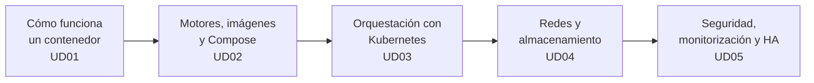

# Despliegue de plataformas de ejecución de contenedores

Apuntes y prácticas del curso **Despliegue de plataformas de ejecución de contenedores: instalación y gestión**, curso **2026/27**. El objetivo es que sepas **planificar, instalar, configurar y administrar** entornos basados en contenedores (Docker, Podman, containerd) y en orquestadores (Kubernetes), y que los dejes listos para producción: con red, almacenamiento persistente, seguridad, monitorización y alta disponibilidad.

> [!NOTE]
> Este módulo forma parte del curso de especialización junto con [Mantenimiento del sistema de contenedores desplegado (5169)](https://lorenalresusta.github.io/Mantenimiento-Contenedores/). La [relación entre los dos módulos](/guia/relacion-modulos/) enlaza cada concepto con el otro, y el [portal de FP](https://lorenalresusta.github.io/FP/) reúne todas las asignaturas por ciclo.

| Característica | Valor |
|---|---|
| **Duración** | **120 horas** (≈ 37 h de teoría y 83 h de prácticas) |
| **Resultados de aprendizaje** | 6 (RA1 a RA6). Consulta la [guía](/guia/ra-ce/) |
| **Entorno de laboratorio** | VirtualBox 7 · Debian 13 · Docker Engine · Podman · kind · kubeadm + Kubernetes 1.36 |
| **Proyecto común** | [BiciAlacant: de un `docker run` a un clúster en alta disponibilidad](/guia/proyecto-bicialacant/) |

> [!NOTE]
> Todo el curso sigue el mismo hilo: **entender el mecanismo → instalarlo → usarlo → romperlo a propósito → comprobar que se recupera**. Por eso casi todas las prácticas terminan con una **prueba de fallo** (parar un contenedor, borrar un Pod, apagar un nodo) y su comprobación.

## El hilo del curso

## Unidades didácticas

Cada unidad tiene una página de **teoría** (conceptos, diagramas, ejemplos y autoevaluación) y una de **prácticas** clasificadas en **guiadas**, **autónomas**, **retos** y **tarea del proyecto**, con su ficha de duración, dificultad, RA/CE, software y entrega.

  
RA1 · 15 h<h3>UD01 · Introducción y virtualización ligera</h3>
Hipervisores frente a contenedores, namespaces, cgroups, sistemas de archivos en capas y estándares OCI.

<a href="ud01-virtualizacion-ligera/ud01-teoria/">Teoría</a> · <a href="ud01-virtualizacion-ligera/ud01-practicas/">Prácticas</a>

  
RA2 · RA3 · 25 h<h3>UD02 · Motores de contenedores</h3>
Docker Engine, Podman y containerd; ciclo de vida, Dockerfile, multi-stage, registros y Docker Compose.

<a href="ud02-motores-contenedores/ud02-teoria/">Teoría</a> · <a href="ud02-motores-contenedores/ud02-practicas/">Prácticas</a>

  
RA4 · 35 h<h3>UD03 · Orquestación con Kubernetes</h3>
Arquitectura del clúster, kind y kubeadm, Pods, Deployments, StatefulSets, actualizaciones, escalado y Helm.

<a href="ud03-kubernetes/ud03-teoria/">Teoría</a> · <a href="ud03-kubernetes/ud03-practicas/">Prácticas</a>

  
RA5 · 20 h<h3>UD04 · Redes y almacenamiento</h3>
Redes de Docker, CNI, Services, Ingress y Gateway API, volúmenes, PV, PVC y StorageClasses.

<a href="ud04-redes-almacenamiento/ud04-teoria/">Teoría</a> · <a href="ud04-redes-almacenamiento/ud04-practicas/">Prácticas</a>

  
RA6 · 25 h<h3>UD05 · Seguridad, monitorización y buenas prácticas</h3>
Contenedores sin privilegios, escaneo de imágenes, RBAC, políticas de red, Prometheus, Grafana, logs y práctica final en HA.

<a href="ud05-seguridad-monitorizacion/ud05-teoria/">Teoría</a> · <a href="ud05-seguridad-monitorizacion/ud05-practicas/">Prácticas</a>

## Relación entre unidades y resultados de aprendizaje

| Unidad | RA1 | RA2 | RA3 | RA4 | RA5 | RA6 | Horas |
|---|:-:|:-:|:-:|:-:|:-:|:-:|--:|
| UD01 Introducción y virtualización ligera | ● | ○ | | | | ○ | 15 |
| UD02 Motores de contenedores | | ● | ● | | ○ | | 25 |
| UD03 Orquestación con Kubernetes | | | | ● | ○ | | 35 |
| UD04 Redes y almacenamiento | | | ○ | ○ | ● | | 20 |
| UD05 Seguridad, monitorización y buenas prácticas | | | | ○ | | ● | 25 |
| **Total** | | | | | | | **120** |

● contribución principal · ○ contribución secundaria. El detalle por criterio está en [Resultados de aprendizaje y criterios de evaluación](/guia/ra-ce/).

## Cómo leer estos apuntes

> [!TIP]
> **Consejo.** Una forma más cómoda o más profesional de hacer algo.

> [!WARNING]
> **Atención.** Un error habitual o algo que puede dar problemas.

> [!IMPORTANT]
> **Clave.** Un concepto imprescindible para el resultado de aprendizaje.

> [!CAUTION]
> **Peligro.** Una operación que puede destruir datos o dejarte sin acceso. Haz antes una instantánea de la máquina virtual.

Las órdenes de los bloques de código se escriben **sin indicador de prompt** para que puedas copiarlas tal cual. Cuando una orden necesita privilegios aparece con `sudo`. Si se muestra la salida esperada, va en un bloque aparte marcado como `text`.
