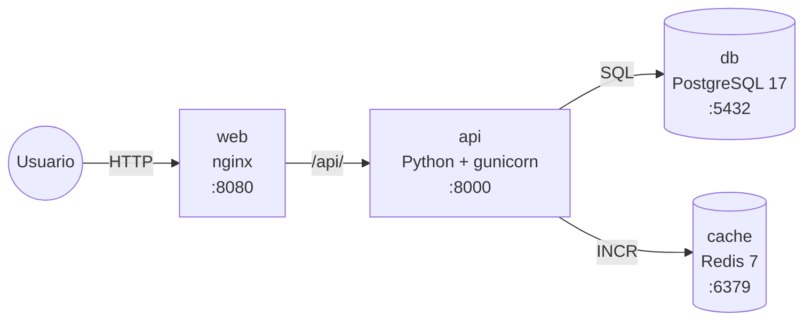

# Proyecto transversal: MiTienda

**MiTienda** es una pequeña tienda online (ficticia). Hoy funciona en un único servidor donde un técnico instaló todo a mano: cuando se actualiza, la web se cae; cuando el disco falló el verano pasado, se perdieron dos semanas de pedidos. La dueña te ha contratado para **contenerizarla y desplegarla en una plataforma moderna**, unidad a unidad, hasta dejarla lista para la campaña de rebajas.

## 1. La aplicación

| Servicio | Imagen | Qué hace | Estado |
|---|---|---|---|
| `web` | `mitienda-web` (construida a partir de `nginxinc/nginx-unprivileged`) | Sirve la página y reenvía `/api/` a la API | Sin estado |
| `api` | `mitienda-api` (construida a partir de `python:3.13-slim`) | Lista productos, procesa compras, cuenta visitas | Sin estado (escalable) |
| `db` | `postgres:17-alpine` | Guarda el catálogo y el stock | **Con estado**: necesita volumen persistente |
| `cache` | `redis:7-alpine` | Contador de visitas | Estado prescindible |

El endpoint `/api/info` devuelve el **nombre del contenedor** que responde: así ves el balanceo de carga cuando hay varias réplicas. `/api/salud` comprueba la base de datos y la caché, y lo usan los *healthchecks* y las sondas de Kubernetes.

## 2. Ficheros del proyecto







Las instrucciones para descargarlo todo en tu máquina están en el [entorno de trabajo](/guia/entorno/#5-recursos-del-proyecto).

## 3. Tareas por unidad

| Unidad | Tarea del proyecto | Resultado |
|---|---|---|
| UD01 | [Análisis de la arquitectura](/ud01-virtualizacion-ligera/ud01-practicas/#tarea-del-proyecto--análisis-de-mitienda) | Documento: qué se conteneriza, qué tiene estado, recursos y riesgos |
| UD02 | [MiTienda con Docker Compose](/ud02-motores-contenedores/ud02-practicas/#práctica-28--mitienda-con-docker-compose) | Imágenes propias publicadas en el registro privado y aplicación completa con Compose |
| UD03 | [MiTienda en Kubernetes](/ud03-kubernetes/ud03-practicas/#práctica-310--mitienda-en-kubernetes) | Manifiestos declarativos, actualización progresiva, *rollback* y escalado |
| UD04 | [Exposición y persistencia](/ud04-redes-almacenamiento/ud04-practicas/#práctica-47--mitienda-expuesta-y-persistente) | Acceso por `http://mitienda.local` y datos que sobreviven a la pérdida del Pod |
| UD05 | [Práctica final: alta disponibilidad](/ud05-seguridad-monitorizacion/ud05-practicas/#práctica-58--práctica-final-mitienda-en-alta-disponibilidad) | Clúster seguro, monitorizado, con políticas de red y simulacro de fallos documentado |

## 4. Requisitos no funcionales (los que pide el cliente)

1. **Disponibilidad.** La web debe seguir respondiendo aunque se caiga un contenedor de la API o un nodo de trabajo.
2. **Actualizaciones sin corte.** Una versión nueva de la API se despliega sin que los usuarios lo noten y, si falla, se vuelve atrás en menos de un minuto.
3. **Persistencia.** Los datos del catálogo y el stock no se pierden al reiniciar, actualizar o mover la base de datos.
4. **Seguridad.** Ningún contenedor se ejecuta como `root`; la base de datos no es accesible desde fuera ni desde la web; las contraseñas no están en el código.
5. **Observabilidad.** Hay paneles con el consumo de cada servicio y una alerta si la API deja de estar disponible.
