# Temporalización

El curso dura **120 horas**. Aproximadamente un **30 %** es teoría (explicación, demostraciones y autoevaluación) y un **70 %** es laboratorio. Las horas de práctica de cada unidad coinciden con la suma de las prácticas de su página.

| Unidad | Teoría | Prácticas | Total | RA |
|---|--:|--:|--:|---|
| [UD01 · Introducción y virtualización ligera](/ud01-virtualizacion-ligera/) | 5 h | 10 h | **15 h** | RA1 |
| [UD02 · Motores de contenedores](/ud02-motores-contenedores/) | 8 h | 17 h | **25 h** | RA2, RA3 |
| [UD03 · Orquproducto con Kubernetes](/ud03-kubernetes/) | 11 h | 24 h | **35 h** | RA4 |
| [UD04 · Redes y almacenamiento](/ud04-redes-almacenamiento/) | 6 h | 14 h | **20 h** | RA5 |
| [UD05 · Seguridad, monitorización y buenas prácticas](/ud05-seguridad-monitorizacion/) | 7 h | 18 h | **25 h** | RA6 |
| **Total** | **37 h** | **83 h** | **120 h** | |

```mermaid
gantt
    title Reparto de las 120 horas (en horas acumuladas)
    dateFormat X
    axisFormat %s h
    section UD01
    Virtualización ligera      :0, 15
    section UD02
    Motores, imágenes y Compose :15, 40
    section UD03
    Kubernetes                  :40, 75
    section UD04
    Redes y almacenamiento      :75, 95
    section UD05
    Seguridad, monitorización y práctica final :95, 120
```

## Organización de una unidad

1. **Presentación** (15 min): qué problema resuelve la unidad y qué RA trabaja.
2. **Teoría por bloques**: cada bloque termina con una demostración en directo y con un ejemplo que puedes repetir en tu máquina.
3. **Prácticas guiadas**: en el laboratorio, con la lista de comprobación al final de cada sesión.
4. **Prácticas autónomas y retos**: aplicas la técnica sin el procedimiento escrito.
5. **Tarea del proyecto MiTienda**: integra lo aprendido en la aplicación común.
6. **Autoevaluación** de la teoría y prueba de la unidad.

## Hitos

| Hito | Cuándo | Qué se comprueba |
|---|---|---|
| H1 · Laboratorio listo | Final de la primera semana | VM de Debian 13 con instantánea limpia y acceso SSH ([entorno](/guia/entorno/)) |
| H2 · MiTienda con Compose | Final de la UD02 | La aplicación arranca con `docker compose up` y sobrevive a la caída de la API |
| H3 · MiTienda en Kubernetes | Final de la UD03 | Despliegue declarativo, actualización progresiva y vuelta atrás |
| H4 · Expuesta y persistente | Final de la UD04 | Acceso por nombre a través del Gateway y datos que sobreviven al borrado del Pod |
| H5 · Práctica final | Final de la UD05 | Alta disponibilidad, seguridad, monitorización y simulacro de fallos con informe |

> [!TIP]
> Si tu grupo tiene un horario fijo (por ejemplo, 6 h semanales), cada unidad ocupa aproximadamente: UD01 2,5 semanas · UD02 4 semanas · UD03 6 semanas · UD04 3,5 semanas · UD05 4 semanas.
