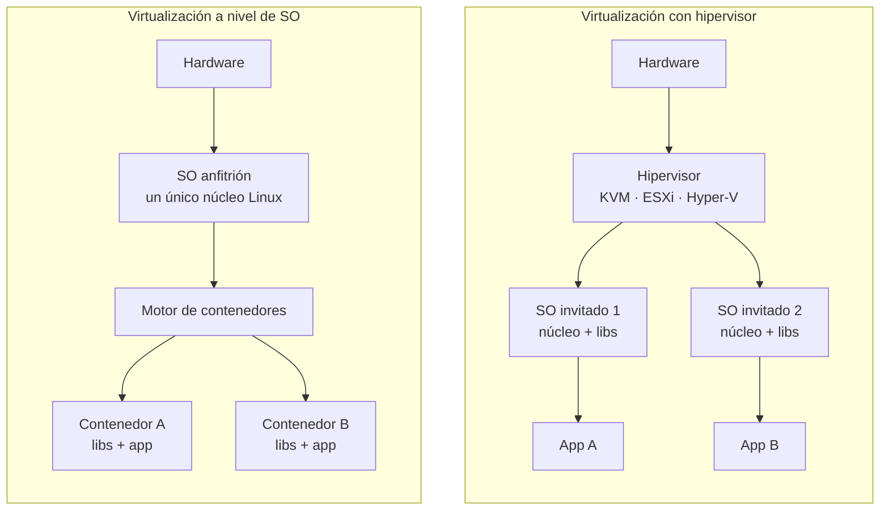
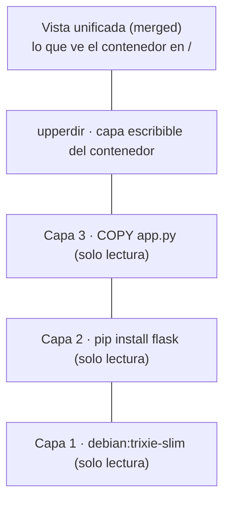
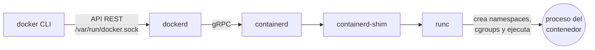

# UD01 · Introducción y virtualización ligera

## Resumen del tema

Una empresa quiere ejecutar veinte aplicaciones en el mismo servidor sin que una rompa a las demás. La respuesta clásica era una **máquina virtual** por aplicación: cada una con su sistema operativo completo, su arranque de un minuto y sus gigas de disco. Los **contenedores** consiguen un aislamiento parecido compartiendo el núcleo del anfitrión: arrancan en milisegundos y ocupan megas. En esta unidad aprenderás **qué piezas del núcleo Linux** lo hacen posible y **cuándo** conviene cada opción.






> [!TIP]
> **Desde cero.** una **máquina virtual** es como alquilar un piso entero —con su cocina y su baño— para cada inquilino; un **contenedor** es como una habitación en un piso compartido: cada uno tiene su espacio, pero la cocina (el núcleo del sistema) es común. Por eso el contenedor ocupa y arranca muchísimo más rápido.

### Objetivos de aprendizaje

- Distinguir virtualización completa, paravirtualización y virtualización a nivel de sistema operativo.
- Explicar qué aísla cada *namespace* de Linux y comprobarlo con `unshare` y `nsenter`.
- Limitar memoria y CPU con **cgroups v2** y leer su contabilidad.
- Entender las capas de una imagen y la **copia en escritura** con OverlayFS.
- Conocer los estándares **OCI** y la cadena *motor → containerd → runc*.
- Elegir entre VM y contenedor con argumentos (portabilidad, eficiencia, seguridad).

---

## 1. El problema: «en mi máquina funciona»

Una aplicación no es solo su código: depende de una versión concreta del intérprete, de bibliotecas del sistema, de variables de entorno y de ficheros de configuración. Cuando el equipo de desarrollo entrega el código a sistemas, cualquier diferencia entre los dos entornos produce errores difíciles de reproducir.

| Enfoque | Qué se entrega | Problema |
|---|---|---|
| Instalación manual | Código + documento de instalación | Cada servidor queda distinto (*configuration drift*) |
| Máquina virtual | Disco completo con SO + aplicación | Pesado (GB), lento de arrancar, hay que parchear cada SO |
| **Contenedor** | **Imagen**: aplicación + dependencias, sin núcleo | Comparte el núcleo: menos aislamiento que una VM |

> [!IMPORTANT]
> Un contenedor **empaqueta la aplicación con su espacio de usuario** (bibliotecas, binarios, configuración) pero **no lleva núcleo**: usa el del anfitrión. De ahí salen todas sus ventajas (ligereza, arranque inmediato) y su principal límite (no puedes ejecutar un contenedor Windows en un núcleo Linux ni cargar módulos de núcleo propios).

---

## 2. Tipos de virtualización



### 2.1 Virtualización completa y paravirtualización

- **Hipervisor de tipo 1** (*bare metal*): se ejecuta directamente sobre el hardware. Ejemplos: VMware ESXi, Microsoft Hyper-V, Xen, KVM (integrado en el núcleo Linux, Proxmox VE lo usa).
- **Hipervisor de tipo 2** (*hosted*): es una aplicación sobre un SO anfitrión. Ejemplos: VirtualBox, VMware Workstation.
- **Virtualización completa**: el invitado no sabe que está virtualizado. Hoy se apoya en las extensiones de la CPU (Intel VT-x, AMD-V).
- **Paravirtualización**: el invitado sabe que está virtualizado y usa controladores especiales para disco y red (VirtIO), mucho más rápidos que emular hardware real.

### 2.2 Virtualización a nivel de sistema operativo

Un único núcleo ejecuta varios **espacios de usuario aislados**. La idea es antigua:

| Año | Tecnología | Qué aportó |
|---|---|---|
| 1979 | `chroot` (Unix V7) | Cambiar la raíz del sistema de archivos de un proceso |
| 2000 | FreeBSD Jails | Aislamiento de procesos, red y usuarios |
| 2004 | Solaris Zones | Contenedores con gestión de recursos |
| 2006-2008 | cgroups y namespaces en Linux | Las piezas del núcleo que usan todos los motores actuales |
| 2008 | LXC | Primer gestor de contenedores completo para Linux |
| 2013 | Docker | Imágenes en capas, Dockerfile y registro: el contenedor como **formato de distribución** |
| 2015 | OCI y CNCF | Estándares abiertos de imagen y ejecución; Kubernetes 1.0 |
| 2020 en adelante | containerd, CRI-O, Podman | Motores modulares, sin demonio, sin privilegios |

### 2.3 Comparación

| Característica | Máquina virtual | Contenedor |
|---|---|---|
| Aislamiento | Fuerte: núcleo propio, frontera de hardware virtual | Medio: núcleo compartido, frontera de *syscalls* |
| Arranque | Decenas de segundos a minutos | Milisegundos a pocos segundos |
| Tamaño típico | GB (SO completo) | MB (solo espacio de usuario) |
| Densidad | Decenas por servidor | Cientos o miles por servidor |
| SO invitado | Cualquiera (Linux, Windows, BSD) | Mismo núcleo que el anfitrión |
| Estado | Normalmente con estado y larga vida | Pensados efímeros e inmutables |
| Gestión | Parchear cada SO invitado | Reconstruir la imagen y sustituir el contenedor |

> [!TIP]
> En la práctica **se combinan**: en la nube los nodos de un clúster Kubernetes son máquinas virtuales y, dentro de ellas, se ejecutan los contenedores. La VM aporta el aislamiento fuerte entre clientes y el contenedor aporta la agilidad de despliegue.

### 2.4 Soluciones intermedias

Para cargas poco fiables (código de terceros, entornos multicliente) existen **sandboxes** que añaden una capa de aislamiento al contenedor:

- **gVisor**: un núcleo en espacio de usuario intercepta las llamadas al sistema.
- **Kata Containers** y **Firecracker**: cada contenedor se ejecuta dentro de una microVM ligera.

Las verás mencionadas en la UD05 como medida de seguridad avanzada.

---

## 3. Un contenedor es un proceso

Si ejecutas un contenedor y miras los procesos del anfitrión, **lo encontrarás**:

```bash
docker run -d --name prueba nginx:alpine
ps -ef | grep "nginx: master"
```

```text
root     14321 14298  0 10:02 ?   00:00:00 nginx: master process nginx -g daemon off;
```

Desde dentro del contenedor ese mismo proceso se ve con **PID 1**. Lo que cambia no es el proceso, sino **lo que el núcleo le deja ver y usar**. Tres mecanismos lo consiguen:

| Mecanismo | Pregunta que responde | Ejemplo |
|---|---|---|
| **Namespaces** | ¿Qué puede **ver** el proceso? | Solo sus procesos, su red, su nombre de host |
| **cgroups** | ¿Cuánto puede **usar**? | 256 MB de RAM, medio núcleo de CPU |
| **Sistema de archivos en capas** | ¿Qué **ficheros** tiene? | La imagen de solo lectura + una capa escribible |

Además, se reducen sus **privilegios** con *capabilities*, *seccomp* y LSM (AppArmor/SELinux).

---

## 4. Namespaces: lo que el proceso ve



Un *namespace* envuelve un recurso global del sistema para que los procesos de dentro crean que tienen su propia instancia aislada.

| Namespace | Aísla | Efecto en un contenedor |
|---|---|---|
| `pid` | Números de proceso | El primer proceso es el PID 1; no ve los procesos del anfitrión |
| `net` | Interfaces, rutas, cortafuegos, puertos | Tiene su propia `eth0` y su propia IP |
| `mnt` | Puntos de montaje | Ve su propio árbol de ficheros |
| `uts` | Nombre de host y dominio | `hostname` devuelve el ID del contenedor |
| `ipc` | Colas de mensajes, memoria compartida System V | No comparte IPC con otros procesos |
| `user` | UID y GID | `root` (UID 0) dentro puede ser el UID 100000 fuera (*rootless*) |
| `cgroup` | Vista de la jerarquía de cgroups | Ve su cgroup como la raíz |
| `time` | Relojes `CLOCK_MONOTONIC` y `BOOTTIME` | Poco usado por los motores |

Cada proceso tiene enlazados sus namespaces en `/proc/<PID>/ns/`:

```bash
ls -l /proc/$$/ns
```

```text
lrwxrwxrwx 1 alumno alumno 0 cgroup -> 'cgroup:[4026531835]'
lrwxrwxrwx 1 alumno alumno 0 net -> 'net:[4026531840]'
lrwxrwxrwx 1 alumno alumno 0 pid -> 'pid:[4026531836]'
...
```

Dos procesos están en el mismo namespace si el número entre corchetes coincide.

### 4.1 Herramientas

| Herramienta | Para qué |
|---|---|
| `unshare` | Ejecutar un programa en namespaces nuevos |
| `nsenter` | Entrar en los namespaces de un proceso existente (así funciona `docker exec`) |
| `lsns` | Listar los namespaces del sistema y sus procesos |
| `ip netns` | Crear y gestionar namespaces de red con nombre |

Ejemplo: una shell con su propio árbol de procesos y su propio nombre de host.

```bash
sudo unshare --pid --fork --mount-proc --uts bash
hostname contenedor-casero
ps -ef        # solo aparecen bash y ps; bash es el PID 1
exit
```

> [!NOTE]
> `--fork` es necesario porque el nuevo namespace de PID se aplica a los **hijos** del proceso que llama a `unshare`. `--mount-proc` monta un `/proc` nuevo; sin él, `ps` seguiría leyendo el `/proc` del anfitrión y mostraría todos los procesos.

### 4.2 El namespace de usuario y los contenedores sin privilegios

El namespace `user` permite que un usuario normal sea `root` **dentro** del namespace sin serlo fuera. Los rangos se definen en `/etc/subuid` y `/etc/subgid`:

```text
alumno:100000:65536
```

El UID 0 del contenedor se corresponde con el UID 1000 (`alumno`) y los UID 1-65535 del contenedor con el rango 100000-165535 del anfitrión. Si un proceso escapa del contenedor, en el anfitrión **no es root**. En esto se basan **Podman rootless** y **Docker rootless** (UD02).

---

## 5. cgroups: lo que el proceso puede usar



Los **grupos de control** organizan los procesos en una jerarquía y aplican a cada grupo límites, prioridades y contabilidad de recursos. Debian 13 usa **cgroups v2** (jerarquía unificada) montada en `/sys/fs/cgroup`.

| Controlador | Ficheros principales | Ejemplo |
|---|---|---|
| `memory` | `memory.max`, `memory.current`, `memory.events` | `256M`: si se supera, el núcleo mata el proceso (*OOM kill*) |
| `cpu` | `cpu.max`, `cpu.weight`, `cpu.stat` | `50000 100000` = 50 ms de cada 100 ms = medio núcleo |
| `pids` | `pids.max` | `100`: frena una *fork bomb* |
| `io` | `io.max`, `io.stat` | Limitar MB/s de lectura o escritura en un disco |
| `cpuset` | `cpuset.cpus` | Fijar el grupo a los núcleos 0 y 1 |

```bash
cat /proc/self/cgroup                      # cgroup del proceso actual
systemd-cgls --no-pager | head -20         # árbol de cgroups de systemd
sudo systemd-run --scope -p MemoryMax=64M -p CPUQuota=20% bash   # shell limitada
```

Docker traduce sus opciones a estos ficheros:

| Opción de `docker run` | Fichero de cgroups v2 |
|---|---|
| `--memory 256m` | `memory.max = 268435456` |
| `--cpus 0.5` | `cpu.max = 50000 100000` |
| `--pids-limit 100` | `pids.max = 100` |
| `--cpu-shares 512` | `cpu.weight` (proporcional) |

> [!WARNING]
> **Un límite de memoria no es una reserva.** `memory.max` impide que el contenedor use más, pero no garantiza que la memoria esté libre. Por eso Kubernetes distingue **requests** (lo que se reserva al planificar) y **limits** (el máximo). Lo verás en la UD03.

---

## 6. Privilegios: capacidades, seccomp y LSM

Ser `root` en Linux es en realidad tener **todas las capacidades** (*capabilities*). El núcleo divide los poderes de root en unas 40 capacidades independientes:

| Capacidad | Permite |
|---|---|
| `CAP_NET_BIND_SERVICE` | Escuchar en puertos menores que 1024 |
| `CAP_CHOWN` | Cambiar el propietario de ficheros |
| `CAP_NET_ADMIN` | Configurar interfaces, rutas y cortafuegos |
| `CAP_SYS_ADMIN` | Montar sistemas de archivos y muchas otras operaciones: «el nuevo root» |
| `CAP_SYS_PTRACE` | Depurar otros procesos |

Docker arranca los contenedores con un **conjunto reducido** de capacidades (unas 14) y sin `CAP_SYS_ADMIN`. Además aplica:

- **seccomp**: un filtro que bloquea unas 40-50 llamadas al sistema peligrosas (`reboot`, `mount`, `kexec_load`…).
- **AppArmor** (Debian/Ubuntu) o **SELinux** (Red Hat): control de acceso obligatorio sobre ficheros y operaciones.

> [!CAUTION]
> `docker run --privileged` **desactiva casi todas estas protecciones**: todas las capacidades, sin seccomp y con acceso a los dispositivos del anfitrión. Un proceso en un contenedor privilegiado puede tomar el control del anfitrión. Solo se usa en casos muy concretos (por ejemplo, ejecutar Docker dentro de Docker para pruebas) y nunca en producción.

---

## 7. Sistemas de archivos en capas

Una **imagen** es una pila de **capas de solo lectura**. Cada capa contiene los ficheros añadidos, modificados o borrados respecto a la anterior. Al crear un contenedor, el motor añade encima una **capa escribible** propia. El controlador **OverlayFS** (`overlay2` en Docker) une las capas en una única vista:



| Operación en el contenedor | Qué ocurre |
|---|---|
| Leer un fichero | Se busca de arriba abajo y se lee de la primera capa que lo tiene |
| Modificar un fichero de la imagen | **Copia en escritura** (*copy-on-write*): se copia a `upperdir` y se modifica allí |
| Borrar un fichero de la imagen | Se crea un *whiteout* en `upperdir` que lo oculta |
| Crear un fichero nuevo | Se escribe directamente en `upperdir` |

Consecuencias prácticas:

1. **Diez contenedores de la misma imagen comparten sus capas**: en disco solo se duplica la capa escribible.
2. Al **borrar el contenedor se pierde su capa escribible**. Los datos que deben durar van en **volúmenes** (UD04).
3. Las capas se **reutilizan entre imágenes**: si dos imágenes parten de `python:3.13-slim`, esa base se descarga una sola vez.
4. Borrar un fichero en una capa posterior **no reduce el tamaño** de la imagen: el fichero sigue en la capa anterior. Por eso en un Dockerfile se instala y se limpia en la misma instrucción `RUN` (UD02).

```bash
docker image inspect nginx:alpine --format '{{json .RootFS.Layers}}' | jq
docker container inspect prueba --format '{{json .GraphDriver.Data}}' | jq
```

---

## 8. Estándares OCI y arquitectura de un motor

En 2015 Docker y otras empresas crearon la **Open Container Initiative (OCI)** para que las imágenes y los entornos de ejecución fueran intercambiables:

| Especificación | Define | Consecuencia |
|---|---|---|
| **Image Spec** | Formato de la imagen: manifiesto, configuración y capas | Una imagen construida con Docker funciona en Podman, containerd o CRI-O |
| **Runtime Spec** | Cómo se ejecuta un *bundle* (rootfs + `config.json`) | Cualquier *runtime* OCI (runc, crun, gVisor, Kata) puede ejecutarla |
| **Distribution Spec** | API HTTP de los registros | Docker Hub, GHCR, Harbor o `registry:2` hablan el mismo protocolo |

La cadena de componentes de Docker Engine:



- **Runtime de alto nivel** (containerd, CRI-O): descarga imágenes, prepara las capas, gestiona el ciclo de vida.
- **Runtime de bajo nivel** (runc, crun): habla con el núcleo para crear el contenedor y termina; el *shim* queda como padre del proceso.
- **Kubernetes** habla directamente con containerd o CRI-O mediante la interfaz **CRI**; no necesita Docker (UD03).

> [!NOTE]
> «Docker» puede significar tres cosas: la **empresa**, el **formato de imagen** (hoy estándar OCI) y el **motor** Docker Engine. Cuando se dice que «Kubernetes ya no usa Docker» se refiere al motor: las imágenes construidas con Docker siguen funcionando igual.

---

## 9. Ventajas, inconvenientes y casos de uso

| Ventaja | Por qué |
|---|---|
| **Portabilidad** | La misma imagen se ejecuta en el portátil, en el servidor de pruebas y en producción |
| **Eficiencia** | Sin SO invitado: más densidad y menos consumo |
| **Velocidad** | Arranque casi inmediato: escalar es crear procesos |
| **Inmutabilidad** | No se parchea un contenedor: se construye una imagen nueva y se sustituye |
| **Consistencia** | Elimina el *configuration drift* entre entornos |

| Inconveniente | Cómo se mitiga |
|---|---|
| Aislamiento más débil que una VM | Sin privilegios, *rootless*, seccomp, sandboxes (UD05) |
| Mismo núcleo para todos | Nodos separados o VM por cliente |
| Datos efímeros por defecto | Volúmenes y almacenamiento persistente (UD04) |
| Complejidad al crecer | Orquestadores como Kubernetes (UD03) |
| Cadena de suministro (imágenes de terceros) | Imágenes oficiales, firmadas y escaneadas (UD05) |

**¿Cuándo una VM?** Otro SO u otro núcleo, aislamiento fuerte entre clientes, software heredado que no se puede rehacer, cargas que necesitan módulos de núcleo propios.
**¿Cuándo un contenedor?** Microservicios, aplicaciones web, entornos de desarrollo reproducibles, CI/CD, cargas que escalan de forma elástica.

---

## 10. Errores frecuentes

| Error | Causa | Solución |
|---|---|---|
| Pensar que un contenedor «tiene su propio Linux» | Confundirlo con una VM | Comprobar con `uname -r` dentro y fuera: el núcleo es el mismo |
| Guardar datos dentro del contenedor | Desconocer la capa escribible efímera | Usar volúmenes |
| `ps` muestra todos los procesos tras `unshare --pid` | No se ha montado un `/proc` nuevo | Añadir `--fork --mount-proc` |
| Usar `--privileged` «para que funcione» | No identificar la capacidad que falta | Añadir solo esa capacidad con `--cap-add` |
| Esperar que `memory.max` reserve memoria | Confundir límite con reserva | Planificar con *requests* en Kubernetes |



## 11. Resumen

- Un contenedor es **un proceso aislado** que comparte el núcleo del anfitrión.
- **Namespaces** = lo que ve; **cgroups** = lo que usa; **capas** = sus ficheros; **capabilities/seccomp/LSM** = lo que puede hacer.
- Las imágenes son capas de solo lectura reutilizables; el contenedor añade una capa escribible que **se pierde al borrarlo**.
- Los estándares **OCI** hacen que imágenes y *runtimes* sean intercambiables; Kubernetes usa containerd o CRI-O a través de **CRI**.
- VM y contenedor **no compiten**: se combinan.

## 12. Autoevaluación


- q: "¿Qué comparten todos los contenedores que se ejecutan en un mismo anfitrión Linux?"
  options: ["El sistema de archivos raíz", "El núcleo del sistema operativo", "La dirección IP", "El árbol de procesos"]
  answer: 1
  explain: "Cada contenedor tiene su propio sistema de archivos, red y procesos gracias a los namespaces, pero todos usan el núcleo del anfitrión."
- q: "¿Qué namespace hace que el primer proceso de un contenedor tenga el PID 1?"
  options: ["`uts`", "`mnt`", "`pid`", "`user`"]
  answer: 2
  explain: "El namespace `pid` crea una numeración de procesos independiente; el primer proceso creado dentro recibe el PID 1."
- q: "Ejecutas `docker run --memory 128m` y la aplicación intenta usar 300 MB. ¿Qué ocurre?"
  options: ["Docker amplía el límite automáticamente", "El núcleo mata el proceso (OOM kill)", "El contenedor se pausa", "La memoria se toma del disco sin límite"]
  answer: 1
  explain: "`--memory` escribe `memory.max` en el cgroup. Al superarlo, el *OOM killer* del núcleo termina el proceso."
- q: "Modificas `/etc/nginx/nginx.conf` dentro de un contenedor cuya imagen ya contiene ese fichero. ¿Dónde queda el cambio?"
  options: ["En la capa de la imagen que contenía el fichero", "En la capa escribible del contenedor, tras copiar el fichero", "En un volumen anónimo", "En todas las capas"]
  answer: 1
  explain: "Es la copia en escritura de OverlayFS: el fichero se copia a `upperdir` y se modifica allí. La imagen no cambia."
- q: "¿Qué especificación de la OCI garantiza que una imagen construida con Docker se pueda ejecutar con Podman?"
  options: ["Runtime Spec", "Image Spec", "Distribution Spec", "CRI"]
  answer: 1
  explain: "La Image Spec define el formato de la imagen (manifiesto, configuración y capas). CRI no es de la OCI: es la interfaz de Kubernetes."
- q: "¿Qué componente crea realmente los namespaces y cgroups de un contenedor en Docker Engine?"
  options: ["`docker` (CLI)", "`dockerd`", "`containerd`", "`runc`"]
  answer: 3
  explain: "runc es el *runtime* de bajo nivel OCI: recibe el *bundle* y pide al núcleo los namespaces y cgroups. Después termina y el *shim* queda como padre."
- q: "Un cliente necesita ejecutar una aplicación de Windows Server en un anfitrión Debian. ¿Qué eliges?"
  options: ["Un contenedor de Docker", "Un contenedor de Podman", "Una máquina virtual", "Un Pod de Kubernetes"]
  answer: 2
  explain: "Los contenedores comparten el núcleo del anfitrión; un núcleo Linux no puede ejecutar binarios de Windows. Hace falta una VM."
- q: "¿Por qué `docker run --privileged` es peligroso?"
  options: ["Porque consume más memoria", "Porque da todas las capacidades, quita seccomp y expone los dispositivos del anfitrión", "Porque deshabilita la red", "Porque impide usar volúmenes"]
  answer: 1
  explain: "Un contenedor privilegiado puede montar discos del anfitrión o cargar módulos: el aislamiento prácticamente desaparece."


## Vídeos y recursos para aprender desde cero






> Los enlaces de vídeo abren una búsqueda en YouTube con el autor recomendado: elige el resultado más reciente y claro. Prioriza siempre vídeos de los últimos años, porque las herramientas cambian.


## Referencias

- Página de manual `namespaces(7)`, `cgroups(7)`, `capabilities(7)` y `unshare(1)`.
- Documentación del núcleo: *Control Group v2* — <https://docs.kernel.org/admin-guide/cgroup-v2.html>
- Documentación del núcleo: *Overlay Filesystem* — <https://docs.kernel.org/filesystems/overlayfs.html>
- Open Container Initiative — <https://opencontainers.org/>
- Docker: *What is a container?* — <https://docs.docker.com/get-started/docker-concepts/the-basics/what-is-a-container/>
