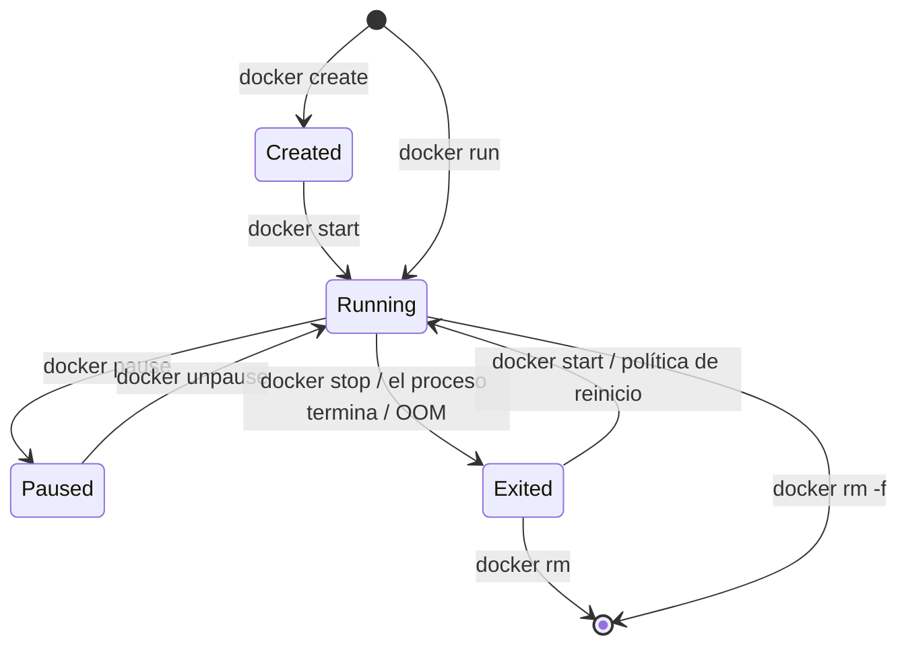

# UD02 · Instalación y configuración de motores de contenedores

## Resumen del tema

En la UD01 creaste un contenedor a mano con media docena de órdenes del núcleo. Un **motor de contenedores** automatiza todo eso y añade lo que hace que los contenedores sean útiles en una empresa: **imágenes** que se construyen de forma reproducible, **registros** para distribuirlas, **redes y volúmenes** gestionados y **aplicaciones de varios servicios** descritas en un fichero. Esta unidad cubre el día a día del administrador con Docker y Podman.



### Objetivos de aprendizaje

- Elegir e instalar un motor (Docker Engine, Podman, containerd) desde fuentes oficiales.
- Configurar el demonio, los permisos y el modo sin privilegios.
- Dominar el ciclo de vida de un contenedor y depurarlo.
- Escribir Dockerfiles eficientes y seguros, con varias etapas.
- Etiquetar, publicar y descargar imágenes de registros públicos y privados.
- Describir una aplicación completa con Docker Compose.

---

## 1. Motores de contenedores

| Motor | Arquitectura | Puntos fuertes | Cuándo usarlo |
|---|---|---|---|
| **Docker Engine** | Demonio `dockerd` + containerd + runc | Ecosistema enorme, Compose, BuildKit, documentación | Desarrollo, servidores pequeños, CI |
| **Podman** | Sin demonio: cada contenedor es hijo del proceso que lo lanza (vía `conmon`) | *Rootless* por defecto, compatible con la CLI de Docker, Pods, integración con systemd (Quadlet) | Servidores Red Hat/Fedora, entornos sin privilegios |
| **containerd** | Demonio ligero con API gRPC, CLI `ctr` o `nerdctl` | Estándar de facto como *runtime* de Kubernetes | Nodos de Kubernetes |
| **CRI-O** | *Runtime* hecho solo para Kubernetes (CRI) | Mínimo, alineado con las versiones de Kubernetes | OpenShift, clústeres Kubernetes |
| **LXC/Incus** | Contenedores de sistema (un SO completo con init) | «VM ligeras» con systemd dentro | Sustituir VM sencillas |

> [!NOTE]
> **Docker Desktop** (Windows y macOS) no es lo mismo que Docker Engine: ejecuta una pequeña VM Linux en la que corre `dockerd`. Su licencia es gratuita para uso personal, educativo y pymes, pero de pago para empresas grandes. En los servidores Linux se instala **Docker Engine**, que es software libre (Apache 2.0).

### 1.1 Docker en Windows

En Windows hay dos tipos de contenedores:

- **Contenedores Linux** (lo habitual): se ejecutan en una VM ligera mediante **WSL 2** (Docker Desktop o Podman Desktop).
- **Contenedores Windows**: comparten el núcleo de Windows; se usan para aplicaciones .NET Framework o IIS. Imágenes base `mcr.microsoft.com/windows/servercore` o `nanoserver`. Deben coincidir con la versión del anfitrión salvo con aislamiento Hyper-V.

---

## 2. Instalación de Docker Engine

### 2.1 Desde el repositorio oficial (Debian 13)

```bash
# 1. Clave GPG y repositorio de Docker
sudo install -m 0755 -d /etc/apt/keyrings
sudo curl -fsSL https://download.docker.com/linux/debian/gpg -o /etc/apt/keyrings/docker.asc
sudo chmod a+r /etc/apt/keyrings/docker.asc

sudo tee /etc/apt/sources.list.d/docker.sources >/dev/null <<EOF
Types: deb
URIs: https://download.docker.com/linux/debian
Suites: $(. /etc/os-release && echo "$VERSION_CODENAME")
Components: stable
Signed-By: /etc/apt/keyrings/docker.asc
EOF

# 2. Paquetes
sudo apt update
sudo apt install -y docker-ce docker-ce-cli containerd.io docker-buildx-plugin docker-compose-plugin
```

| Paquete | Contiene |
|---|---|
| `docker-ce` | El demonio `dockerd` |
| `docker-ce-cli` | La orden `docker` |
| `containerd.io` | containerd y runc |
| `docker-buildx-plugin` | `docker buildx`: construcción con BuildKit, multiplataforma |
| `docker-compose-plugin` | `docker compose` (Compose v2, escrito en Go) |

> [!WARNING]
> **`docker-compose` (con guion) es Compose v1**, escrito en Python y abandonado desde 2023. Usa siempre **`docker compose`** (con espacio). Del mismo modo, el campo `version:` al principio de un `compose.yaml` ya es obsoleto y solo genera un aviso.

### 2.2 Post-instalación

```bash
sudo systemctl enable --now docker containerd
sudo docker run --rm hello-world
sudo usermod -aG docker "$USER"     # cierra la sesión para que tenga efecto
```

> [!CAUTION]
> **Pertenecer al grupo `docker` equivale a ser `root`.** Quien puede hablar con `/var/run/docker.sock` puede ejecutar `docker run -v /:/host --privileged ...` y modificar cualquier fichero del anfitrión. Da ese grupo solo a administradores, o usa el modo *rootless*.

### 2.3 Configuración del demonio: `/etc/docker/daemon.json`

```json
{
  "log-driver": "json-file",
  "log-opts": { "max-size": "10m", "max-file": "3" },
  "default-address-pools": [ { "base": "172.30.0.0/16", "size": 24 } ],
  "live-restore": true,
  "userland-proxy": false,
  "features": { "buildkit": true }
}
```

| Opción | Para qué |
|---|---|
| `log-opts` | Rotar los registros de los contenedores: sin esto pueden llenar el disco |
| `default-address-pools` | Rango de las redes que crea Docker (evita choques con la red de la empresa) |
| `live-restore` | Los contenedores siguen funcionando mientras se reinicia o actualiza `dockerd` |
| `userland-proxy` | Publicar puertos con reglas del núcleo en lugar de un proceso proxy |
| `data-root` | Mover `/var/lib/docker` a otro disco |
| `insecure-registries` | Registros sin TLS (solo laboratorio) |

Tras cambiarlo: `sudo systemctl restart docker` y `docker info` para comprobarlo.

### 2.4 Modo sin privilegios (*rootless*)

El demonio se ejecuta con tu usuario dentro de un namespace de usuario (UD01). Un escape del contenedor no da `root` en el anfitrión.

```bash
sudo apt install -y uidmap dbus-user-session slirp4netns
sudo systemctl disable --now docker.service docker.socket   # o mantenerlo para otros usuarios
dockerd-rootless-setuptool.sh install
export DOCKER_HOST=unix://$XDG_RUNTIME_DIR/docker.sock
docker context ls
```

Limitaciones: no puede publicar puertos menores que 1024 sin ajustar `net.ipv4.ip_unprivileged_port_start`, la red es algo más lenta y algunos controladores de almacenamiento no están disponibles.

### 2.5 Contextos

Un **contexto** indica a qué motor habla la CLI. Sirve para gestionar un servidor remoto por SSH sin exponer el socket:

```bash
docker context create servidor --docker "host=ssh://alumno@192.168.56.11"
docker context use servidor
docker ps            # contenedores del servidor remoto
docker context use default
```

---

## 3. Ciclo de vida de un contenedor



### 3.1 Órdenes esenciales

| Orden | Qué hace |
|---|---|
| `docker run -d --name web -p 8080:80 nginx:1.29-alpine` | Crea y arranca en segundo plano, publica el puerto 80 en el 8080 del anfitrión |
| `docker run -it --rm debian:trixie-slim bash` | Interactivo, se borra al salir |
| `docker ps` / `docker ps -a` | Contenedores en marcha / todos |
| `docker stop web` | Envía `SIGTERM`; a los 10 s, `SIGKILL` |
| `docker start web` / `docker restart web` | Arranca / reinicia uno existente |
| `docker exec -it web sh` | Ejecuta un proceso dentro (usa `nsenter`) |
| `docker logs -f --tail 50 web` | Salida estándar y de error del proceso principal |
| `docker inspect web` | Toda la configuración y el estado en JSON |
| `docker top web` · `docker stats` | Procesos y consumo |
| `docker cp web:/etc/nginx/nginx.conf .` | Copia ficheros entre contenedor y anfitrión |
| `docker rm web` · `docker container prune` | Borra uno / todos los parados |
| `docker events` | Flujo de eventos del motor (útil para depurar) |

### 3.2 Opciones de `docker run` que hay que conocer

| Opción | Ejemplo | Efecto |
|---|---|---|
| `-e`, `--env-file` | `-e TZ=Europe/Madrid` | Variables de entorno |
| `-p` | `-p 127.0.0.1:8080:80` | Publica solo en una IP del anfitrión |
| `-v`, `--mount` | `-v datos:/var/lib/mysql` | Volúmenes (UD04) |
| `--restart` | `no`, `on-failure[:N]`, `always`, `unless-stopped` | Política de reinicio |
| `--memory`, `--cpus`, `--pids-limit` | `--memory 256m --cpus 1` | Límites con cgroups |
| `--user` | `--user 1000:1000` | Usuario del proceso |
| `--read-only`, `--cap-drop`, `--security-opt` | `--cap-drop ALL` | Endurecimiento (UD05) |
| `--health-cmd` | `--health-cmd "curl -f http://localhost/"` | Comprobación de salud |
| `--init` | | Añade un mini-init como PID 1 que reenvía señales y recoge zombis |

> [!IMPORTANT]
> **El contenedor vive lo que vive su proceso principal.** Si el proceso con PID 1 termina, el contenedor pasa a `Exited`. Por eso los servicios dentro de un contenedor se ejecutan **en primer plano** (`nginx -g 'daemon off;'`) y no con `systemctl`.

### 3.3 Depuración



Un contenedor que no arranca se diagnostica siempre en el mismo orden:

1. `docker ps -a` → estado y **código de salida** (`Exited (1)`, `Exited (137)` = matado por `SIGKILL`/OOM, `Exited (127)` = orden no encontrada).
2. `docker logs <c>` → el error de la aplicación.
3. `docker inspect <c> --format '{{json .State}}'` → `OOMKilled`, `Error`, `Health`.
4. `docker run -it --entrypoint sh <imagen>` → entrar en la imagen sin ejecutar la aplicación y probar a mano.
5. `docker events` → qué ha hecho el motor y cuándo.

---

## 4. Imágenes, etiquetas y registros

### 4.1 Nombre completo de una imagen

```text
registro.local:5000/mitienda/api:1.2.0@sha256:4f3c...
└────── registro ─────┘└─ repositorio ─┘└tag┘└──── digest ────┘
```

- **Registro**: si se omite, Docker usa `docker.io`. Las imágenes oficiales están en `docker.io/library/`.
- **Etiqueta (*tag*)**: un nombre **móvil** que el autor puede reasignar. `latest` es solo una etiqueta más, no «la última».
- **Digest**: el hash SHA-256 del manifiesto. Es **inmutable**: identifica exactamente una imagen.

> [!WARNING]
> **No uses `latest` en producción.** Hoy puede ser la 1.2 y mañana la 2.0 con cambios incompatibles. Fija la versión (`nginx:1.29-alpine`) o, para máxima reproducibilidad, el digest.

### 4.2 Estrategia de etiquetado



Con **versionado semántico** (MAYOR.MENOR.PARCHE) se publican varias etiquetas que apuntan a la misma imagen:

| Etiqueta | Se mueve con | Quién la usa |
|---|---|---|
| `1.2.3` | Nunca | Producción |
| `1.2` | Cada parche | Quien acepta parches automáticos |
| `1` | Cada versión menor | Entornos de pruebas |
| `sha-4f3c2a1` | Nunca (commit de Git) | CI/CD, trazabilidad |

### 4.3 Registros

| Registro | Tipo | Notas |
|---|---|---|
| Docker Hub | Público/privado | Límite de descargas para usuarios anónimos; inicia sesión |
| GitHub Container Registry (`ghcr.io`) | Público/privado | Integrado con GitHub Actions |
| Quay.io, Amazon ECR, Google Artifact Registry, Azure ACR | Nube | Integrados con sus clústeres gestionados |
| **`registry:3`** (CNCF Distribution) | Autoalojado | Mínimo: API de registro, sin interfaz web |
| **Harbor** | Autoalojado | Interfaz web, proyectos, RBAC, escaneo de vulnerabilidades, firma, replicación |

```bash
docker login registro.local:5000
docker tag mitienda-api:1.0.0 registro.local:5000/mitienda/api:1.0.0
docker push registro.local:5000/mitienda/api:1.0.0
docker pull registro.local:5000/mitienda/api:1.0.0
```

---

## 5. Construir imágenes: Dockerfile

### 5.1 Instrucciones

| Instrucción | Para qué | Crea capa |
|---|---|:-:|
| `FROM imagen:tag [AS etapa]` | Imagen base | — |
| `RUN orden` | Ejecuta durante la construcción | Sí |
| `COPY origen destino` | Copia ficheros del contexto | Sí |
| `ADD` | Como `COPY`, pero descomprime tar y descarga URL: **evítalo** salvo para eso | Sí |
| `WORKDIR /app` | Directorio de trabajo | Metadato |
| `ENV CLAVE=valor` | Variable en construcción y ejecución | Metadato |
| `ARG CLAVE=valor` | Variable solo en construcción (`--build-arg`) | Metadato |
| `EXPOSE 8000` | Documenta el puerto (no lo publica) | Metadato |
| `USER 10001` | Usuario de las instrucciones siguientes y del contenedor | Metadato |
| `HEALTHCHECK CMD ...` | Comprobación de salud | Metadato |
| `LABEL clave=valor` | Metadatos (autor, versión, origen) | Metadato |
| `ENTRYPOINT [...]` | Ejecutable fijo | Metadato |
| `CMD [...]` | Argumentos por defecto (o la orden si no hay `ENTRYPOINT`) | Metadato |

### 5.2 `ENTRYPOINT` y `CMD`

| Dockerfile | `docker run img` ejecuta | `docker run img otra` ejecuta |
|---|---|---|
| `CMD ["nginx","-g","daemon off;"]` | `nginx -g daemon off;` | `otra` |
| `ENTRYPOINT ["ping"]` + `CMD ["-c","3","localhost"]` | `ping -c 3 localhost` | `ping otra` |

Usa siempre la **forma exec** (`["prog","arg"]`). La forma *shell* (`CMD prog arg`) lanza `/bin/sh -c`, que se convierte en PID 1 y **no reenvía `SIGTERM`**: el contenedor tarda 10 s en pararse y acaba con `SIGKILL`.

### 5.3 La caché de construcción

Cada instrucción genera una capa que se guarda en caché. Si una instrucción y sus entradas no cambian, se reutiliza; **en cuanto una cambia, se reconstruyen ella y todas las siguientes**. Por eso el orden importa:

```dockerfile
# MAL: cualquier cambio en el código reinstala todas las dependencias
COPY . .
RUN pip install -r requirements.txt

# BIEN: las dependencias solo se reinstalan si cambia requirements.txt
COPY requirements.txt .
RUN pip install --no-cache-dir -r requirements.txt
COPY . .
```

### 5.4 Buenas prácticas

1. **Imagen base pequeña y oficial**: `-slim`, `-alpine` o *distroless*. Fija la versión.
2. **Ordena de lo que menos cambia a lo que más.**
3. **Agrupa y limpia en el mismo `RUN`**: `apt-get update && apt-get install -y --no-install-recommends ... && rm -rf /var/lib/apt/lists/*`.
4. **`.dockerignore`** para no enviar al demonio `.git`, `node_modules`, secretos o ficheros grandes.
5. **Un proceso por contenedor**.
6. **No ejecutes como `root`**: crea un usuario y usa `USER` (UD05).
7. **Nunca metas secretos** en `ENV`, `ARG` ni en ficheros copiados: quedan en las capas y cualquiera con la imagen los lee con `docker history`. Usa secretos de BuildKit (`RUN --mount=type=secret`) si los necesitas al construir.
8. **Etiquetas OCI** (`org.opencontainers.image.source`, `version`…) para trazabilidad.

### 5.5 Construcción en varias etapas (*multi-stage*)

Separa la **etapa de compilación** (compilador, cabeceras, herramientas) de la **etapa final** (solo el resultado). La imagen final no contiene nada de la primera:

```dockerfile
# syntax=docker/dockerfile:1
FROM golang:1.25 AS build
WORKDIR /src
COPY go.mod ./
RUN go mod download
COPY . .
RUN CGO_ENABLED=0 go build -ldflags="-s -w" -o /saludo .

FROM gcr.io/distroless/static-debian12:nonroot
COPY --from=build /saludo /saludo
USER nonroot
ENTRYPOINT ["/saludo"]
```

| Imagen | Tamaño aproximado |
|---|--:|
| `golang:1.25` (etapa de compilación) | ~800 MB |
| Imagen final *distroless* + binario | ~10 MB |

### 5.6 BuildKit y buildx

BuildKit es el constructor por defecto. Aporta caché paralela, secretos de construcción, montajes de caché (`RUN --mount=type=cache,target=/root/.cache/pip`) y construcción **multiplataforma**:

```bash
docker buildx build --platform linux/amd64,linux/arm64 -t registro.local:5000/app:1.0 --push .
```

---

## 6. Docker Compose

Compose describe en un fichero YAML (`compose.yaml`) **todos los servicios, redes, volúmenes, configuraciones y secretos** de una aplicación, y los gestiona como una unidad.

### 6.1 Estructura

```yaml
name: tienda
services:
  web:
    image: nginx:1.29-alpine
    ports: ["8080:80"]
    depends_on:
      api: { condition: service_healthy }
  api:
    build: ./api
    environment:
      DB_HOST: db
    env_file: .env
    healthcheck:
      test: ["CMD", "curl", "-f", "http://localhost:8000/salud"]
      interval: 10s
  db:
    image: postgres:17-alpine
    volumes: [datos:/var/lib/postgresql/data]
volumes:
  datos: {}
```

### 6.2 Conceptos clave

- **Nombre del proyecto** (`name:` o el nombre de la carpeta): prefijo de contenedores, redes y volúmenes.
- **Red por defecto**: Compose crea una red *bridge* propia y cada servicio es accesible **por su nombre** (`db`, `api`) gracias al DNS interno de Docker.
- **`depends_on`** controla el orden de arranque. Con `condition: service_healthy` espera a que el *healthcheck* del otro servicio pase: sin eso, «arrancado» no significa «listo».
- **Variables**: `${VARIABLE:-valor}` se sustituye con el entorno o con el fichero `.env` de la carpeta.
- **Perfiles** (`profiles: [debug]`): servicios que solo arrancan con `--profile debug`.
- **Varios ficheros**: `compose.yaml` + `compose.override.yaml` (se fusionan automáticamente) o `-f compose.prod.yaml`.

### 6.3 Órdenes

| Orden | Qué hace |
|---|---|
| `docker compose up -d [--build]` | Crea y arranca todo (reconstruye si se pide) |
| `docker compose ps` / `logs -f api` | Estado / registros |
| `docker compose exec db psql -U producto` | Entra en un servicio |
| `docker compose up -d --scale api=3` | Varias réplicas de un servicio (sin puerto fijo publicado) |
| `docker compose config` | Muestra el fichero final con variables resueltas (valida la sintaxis) |
| `docker compose down` | Para y borra contenedores y redes |
| `docker compose down -v` | …y **también los volúmenes** (¡datos!) |
| `docker compose watch` | Sincroniza o reconstruye al cambiar el código (desarrollo) |

---

## 7. Configuración y secretos



La **misma imagen** debe servir para desarrollo, pruebas y producción. Lo que cambia entre entornos se inyecta al ejecutar:

| Mecanismo | Uso | Riesgo |
|---|---|---|
| Variables de entorno (`-e`, `environment`) | Configuración no sensible | Se ven en `docker inspect` y en `/proc/<pid>/environ` |
| Fichero `.env` | Valores por entorno para Compose | No subirlo a Git si contiene secretos |
| Ficheros montados (`configs`, `-v ./app.conf:/etc/app.conf:ro`) | Ficheros de configuración | — |
| **Secretos de Compose** (`secrets:`) | Contraseñas, claves | Se montan en `/run/secrets/<nombre>` como fichero, no como variable |

Muchas imágenes oficiales aceptan la variante `_FILE` de sus variables: `POSTGRES_PASSWORD_FILE=/run/secrets/db_password`. La API de MiTienda hace lo mismo con `DB_PASSWORD_FILE`.

---

## 8. Errores frecuentes

| Error | Causa | Solución |
|---|---|---|
| `permission denied ... docker.sock` | El usuario no está en el grupo `docker` o no ha reiniciado sesión | `newgrp docker` o cerrar sesión |
| `port is already allocated` | Otro contenedor o servicio usa ese puerto | `ss -tlnp` y cambiar el puerto publicado |
| El contenedor se para nada más arrancar | El proceso principal termina (servicio en segundo plano, orden errónea) | `docker logs`, proceso en primer plano |
| `Exited (137)` | `SIGKILL`: OOM o parada lenta | `docker inspect --format '{{.State.OOMKilled}}'`; subir memoria o usar forma exec |
| La API no conecta con la base de datos al arrancar | `depends_on` sin condición: la BD aún no está lista | *Healthcheck* + `condition: service_healthy` y reintentos en la app |
| Imagen enorme | Base completa, capas sin limpiar, sin `.dockerignore` | `-slim`, *multi-stage*, limpiar en el mismo `RUN` |
| `toomanyrequests` al descargar | Límite de Docker Hub para anónimos | `docker login` o *mirror* propio |
| `docker compose down -v` borró los datos | `-v` elimina los volúmenes con nombre | No usar `-v` salvo que se quiera empezar de cero |

## 9. Resumen

- Docker Engine = `dockerd` + containerd + runc. Podman no tiene demonio y es *rootless* por defecto. Ambos usan imágenes OCI.
- El grupo `docker` da privilegios de `root`: usa *rootless* o contextos SSH.
- Un contenedor vive mientras vive su PID 1; se depura con `ps -a`, `logs`, `inspect` y `events`.
- Las etiquetas se mueven, los *digest* no. Nunca `latest` en producción.
- Dockerfile: orden para aprovechar la caché, *multi-stage* para imágenes pequeñas, usuario sin privilegios, sin secretos.
- Compose describe la aplicación completa; `depends_on` con *healthcheck* asegura el orden real de arranque.

## 10. Autoevaluación


- q: "¿Qué paquete proporciona la orden `docker compose` en una instalación desde el repositorio oficial?"
  options: ["`docker-compose`", "`docker-compose-plugin`", "`docker-ce`", "`containerd.io`"]
  answer: 1
  explain: "Compose v2 se distribuye como plugin de la CLI (`docker-compose-plugin`). `docker-compose` con guion es la versión 1, abandonada."
- q: "¿Por qué añadir un usuario al grupo `docker` es un riesgo?"
  options: ["Porque consume más recursos", "Porque puede lanzar contenedores privilegiados y montar el sistema de archivos del anfitrión, es decir, obtener root", "Porque desactiva el cortafuegos", "No es un riesgo"]
  answer: 1
  explain: "El socket de Docker da control total del demonio, que se ejecuta como root."
- q: "Un contenedor aparece como `Exited (137)`. ¿Qué es lo primero que compruebas?"
  options: ["Si la imagen existe", "Si fue matado por OOM con `docker inspect --format '{{.State.OOMKilled}}'`", "La versión de Docker", "El fichero `daemon.json`"]
  answer: 1
  explain: "137 = 128 + 9 (SIGKILL). Las causas típicas son superar el límite de memoria o no responder a SIGTERM a tiempo."
- q: "¿Qué orden de instrucciones aprovecha mejor la caché al construir una aplicación Python?"
  options: ["`COPY . .` y luego `RUN pip install -r requirements.txt`", "`COPY requirements.txt .`, `RUN pip install ...` y luego `COPY . .`", "`RUN pip install` antes del `FROM`", "Da igual el orden"]
  answer: 1
  explain: "Así, un cambio en el código no invalida la capa de dependencias."
- q: "¿Cuál es la principal ventaja de una construcción *multi-stage*?"
  options: ["Construye más rápido siempre", "La imagen final no contiene compiladores ni herramientas de construcción", "Permite usar varios registros", "Evita usar Dockerfile"]
  answer: 1
  explain: "Solo se copia a la etapa final el resultado; la imagen es más pequeña y tiene menos superficie de ataque."
- q: "¿Qué diferencia hay entre una etiqueta y un *digest*?"
  options: ["Ninguna", "La etiqueta puede moverse a otra imagen; el *digest* identifica una imagen concreta de forma inmutable", "El *digest* solo existe en Docker Hub", "La etiqueta es un hash"]
  answer: 1
  explain: "El *digest* es el SHA-256 del manifiesto: si cambia un solo byte, cambia el *digest*."
- q: "En Compose, la API falla al arrancar porque la base de datos «aún no está lista». ¿Qué lo resuelve?"
  options: ["Poner la base de datos antes en el fichero", "`depends_on` con `condition: service_healthy` y un *healthcheck* en la base de datos", "`restart: no`", "Usar `links`"]
  answer: 1
  explain: "El orden del fichero no importa; `depends_on` simple solo espera a que el contenedor arranque, no a que el servicio esté listo."
- q: "¿Qué ocurre con una contraseña definida con `ENV` en un Dockerfile?"
  options: ["Se cifra automáticamente", "Queda guardada en la configuración de la imagen y la ve cualquiera con `docker inspect` o `docker history`", "Solo existe durante la construcción", "Se borra al hacer `docker push`"]
  answer: 1
  explain: "Los secretos se inyectan al ejecutar (secretos de Compose, Secrets de Kubernetes), nunca en la imagen."


## Referencias

- Docker: *Install Docker Engine on Debian* — <https://docs.docker.com/engine/install/debian/>
- Docker: *Rootless mode* — <https://docs.docker.com/engine/security/rootless/>
- Docker: *Dockerfile reference* y *Building best practices* — <https://docs.docker.com/build/building/best-practices/>
- Compose Specification — <https://compose-spec.io/>
- Podman — <https://docs.podman.io/>
- CNCF Distribution (registro) — <https://distribution.github.io/distribution/> · Harbor — <https://goharbor.io/>
