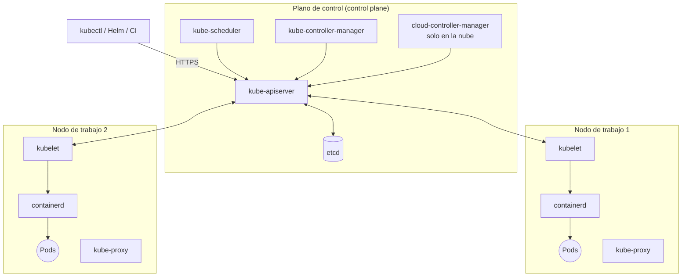
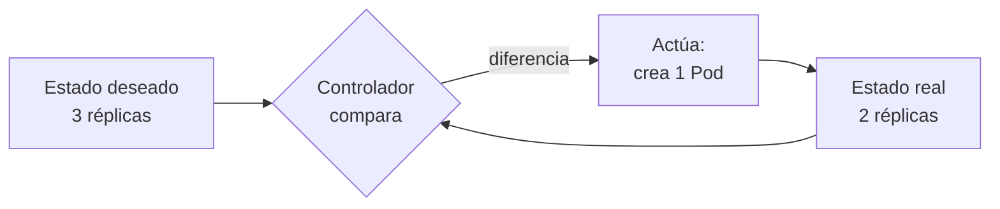
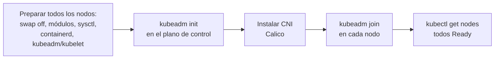
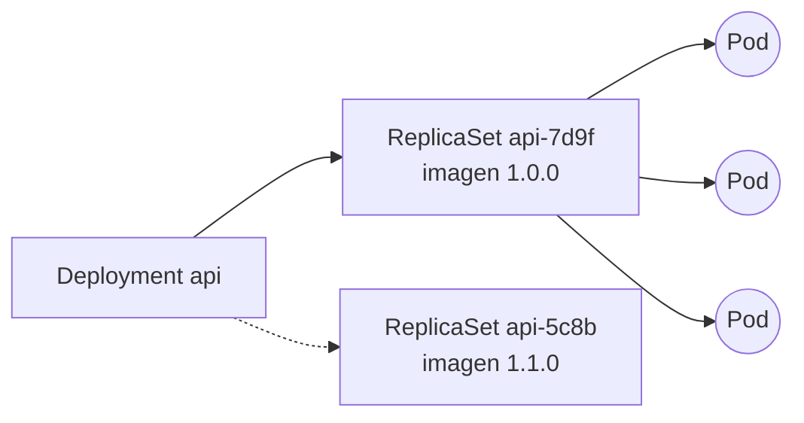

# UD03 · Orquestación de contenedores con Kubernetes

## Resumen del tema

Un **orquestador** gestiona contenedores en un **conjunto de máquinas** como si fueran una sola: decide en qué nodo se ejecuta cada contenedor, lo reinicia si falla, lo mueve si cae un nodo, reparte el tráfico, actualiza versiones sin corte y escala según la carga. **Kubernetes** (K8s) es el orquestador estándar de la industria. La idea clave de la unidad: en Kubernetes **no das órdenes, declaras el estado deseado**, y el clúster trabaja sin descanso para que el estado real coincida con él.



### Objetivos de aprendizaje

- Describir los componentes del plano de control y de los nodos y su función.
- Desplegar clústeres de pruebas (kind, Minikube) y de producción (kubeadm, servicios gestionados).
- Escribir manifiestos YAML y gestionarlos con `kubectl apply`.
- Elegir el objeto adecuado: Pod, Deployment, StatefulSet, DaemonSet, Job o CronJob.
- Separar configuración y secretos de la imagen; definir sondas y recursos.
- Actualizar con *rolling update*, revertir con *rollback* y escalar manual y automáticamente.
- Empaquetar aplicaciones con Helm y Kustomize.

---

## 1. ¿Por qué orquestar?

| Necesidad | Con Compose en un servidor | Con Kubernetes |
|---|---|---|
| Un contenedor falla | Política de reinicio local | Se reinicia **o se recrea en otro nodo** |
| Cae el servidor | Cae todo | Las cargas se reprograman en los nodos sanos |
| Más carga | `--scale` a mano en una máquina | Escalado automático de réplicas (HPA) y de nodos |
| Nueva versión | `down` + `up`: hay corte | *Rolling update* sin corte y *rollback* con una orden |
| Balanceo | Manual (nginx) | Services con IP virtual y DNS |
| Configuración y secretos | `.env`, ficheros | ConfigMaps y Secrets versionados como objetos |

Kubernetes nació en Google en 2014, inspirado en su sistema interno **Borg**, y hoy lo mantiene la **CNCF**. Publica tres versiones al año (la actual es la **1.36**, de abril de 2026) y cada una tiene soporte durante unos 14 meses.

> [!NOTE]
> **Docker Swarm** es el orquestador integrado en Docker: más sencillo, con los mismos ficheros de Compose (`docker stack deploy`), pero con mucho menos ecosistema. Lo usarás en la UD04 para las redes *overlay*. **Nomad** (HashiCorp) es otra alternativa, que también orquesta procesos y VM.

---

## 2. Arquitectura de un clúster



### 2.1 Plano de control

| Componente | Función |
|---|---|
| **kube-apiserver** | La **única puerta** del clúster: API REST que autentica, autoriza, valida y guarda los objetos. Todo pasa por él |
| **etcd** | Base de datos clave-valor distribuida (consenso Raft) con **todo el estado del clúster**. Sin copia de etcd no hay recuperación |
| **kube-scheduler** | Elige el nodo de cada Pod nuevo según recursos, afinidades, *taints* y restricciones |
| **kube-controller-manager** | Ejecuta los **controladores**: bucles que comparan estado deseado y real (ReplicaSet, Deployment, Node, Job…) |
| **cloud-controller-manager** | Habla con la nube: balanceadores, discos, rutas |

### 2.2 Nodos de trabajo

| Componente | Función |
|---|---|
| **kubelet** | Agente del nodo: recibe los Pods asignados, pide al *runtime* que los cree, ejecuta las sondas e informa del estado |
| **Container runtime** | containerd o CRI-O, a través de la interfaz **CRI** |
| **kube-proxy** | Programa las reglas (nftables/iptables o IPVS) que implementan las IP virtuales de los Services |
| **Complemento CNI** | Red de los Pods (Calico, Cilium, Flannel…). Se ve en la UD04 |

Complementos habituales: **CoreDNS** (DNS interno), **metrics-server** (métricas para `kubectl top` y HPA), controlador de entrada (UD04).

### 2.3 El bucle de reconciliación



Si borras un Pod de un Deployment, el controlador de ReplicaSet detecta que hay 2 en lugar de 3 y crea otro. **No hay que darle la orden**: está en el estado deseado.

### 2.4 Qué ocurre al hacer `kubectl apply`

1. `kubectl` envía el manifiesto al **apiserver**, que autentica (¿quién eres?), autoriza con RBAC (¿puedes?), pasa los **controladores de admisión** (¿es válido? ¿cumple las políticas?) y lo guarda en **etcd**.
2. El **controlador de Deployment** crea un ReplicaSet; el de **ReplicaSet** crea los Pods (sin nodo asignado).
3. El **scheduler** ve Pods sin nodo y les asigna uno.
4. El **kubelet** de ese nodo ve un Pod asignado y pide a **containerd** que descargue la imagen y arranque los contenedores.
5. El kubelet ejecuta las **sondas** e informa: el Pod pasa a `Running` y `Ready`.

---

## 3. Formas de instalar Kubernetes

| Opción | Para qué | Nodos | Notas |
|---|---|---|---|
| **kind** (*Kubernetes in Docker*) | Pruebas, CI, laboratorio | Cada nodo es un contenedor Docker | Arranca en 1 minuto, varios nodos en una máquina |
| **Minikube** | Aprendizaje en un portátil | Uno (o varios) en VM o contenedor | Complementos con `minikube addons` |
| **k3s / k0s** | Edge, IoT, laboratorios ligeros | Uno o varios | Un único binario, incluye Traefik y almacenamiento local |
| **kubeadm** | Clúster «de verdad» autogestionado | Varios | La herramienta oficial de arranque; tú gestionas SO, red, actualizaciones y etcd |
| **Gestionados** (EKS, GKE, AKS) | Producción en la nube | Varios | El proveedor gestiona el plano de control; tú pagas y gestionas los nodos y las cargas |

**¿Gestionado o propio?** Un servicio gestionado quita el trabajo más delicado (etcd, actualizaciones del plano de control, alta disponibilidad de la API) a cambio de coste y dependencia del proveedor. Un clúster propio da control total y sirve en local (datos que no pueden salir del centro), pero exige un equipo que lo opere.

### 3.1 kubeadm en resumen



`kubeadm init` genera los certificados de la PKI del clúster, arranca el plano de control como **Pods estáticos** (manifiestos en `/etc/kubernetes/manifests/`), crea el `kubeconfig` de administrador y muestra la orden `kubeadm join` con un *token* para unir nodos. El procedimiento completo está en la [práctica 3.7](/ud03-kubernetes/ud03-practicas/#práctica-37--clúster-de-tres-nodos-con-kubeadm).

### 3.2 `kubectl` y `kubeconfig`

`kubectl` lee `~/.kube/config`, que contiene **clústeres**, **usuarios** (certificados o *tokens*) y **contextos** (clúster + usuario + espacio de nombres):

```bash
kubectl config get-contexts
kubectl config use-context kind-curso
kubectl config set-context --current --namespace=bicialacant
```

> [!CAUTION]
> El `admin.conf` que genera kubeadm tiene **permisos totales e irrevocables** sobre el clúster. Trátalo como la contraseña de `root`: no lo copies a sitios compartidos ni lo subas a Git. En la UD05 crearás usuarios con permisos limitados.

---

## 4. El modelo declarativo: objetos y YAML

Todo en Kubernetes es un **objeto** de la API con la misma estructura:

```yaml
apiVersion: apps/v1          # grupo/versión de la API
kind: Deployment             # tipo de objeto
metadata:                    # identidad: nombre, espacio de nombres, etiquetas, anotaciones
  name: web
  namespace: tienda
  labels: {app: web, tier: frontal}
spec:                        # ESTADO DESEADO (lo escribes tú)
  replicas: 3
  ...
status:                      # ESTADO REAL (lo escribe el clúster; no se edita)
  readyReplicas: 3
```

| Forma de trabajar | Ejemplo | Uso |
|---|---|---|
| Imperativa | `kubectl create deployment web --image=nginx` | Pruebas rápidas |
| Imperativa generando YAML | `kubectl create deployment web --image=nginx --dry-run=client -o yaml > web.yaml` | **Plantilla** para empezar un manifiesto |
| **Declarativa** | `kubectl apply -f web.yaml` (o `-f carpeta/`) | **Siempre en producción**: los YAML van a Git |

- **Etiquetas (*labels*)**: pares clave-valor para **seleccionar** objetos (`app=web`). Los Services y los controladores encuentran sus Pods por etiquetas.
- **Anotaciones**: metadatos para herramientas, no se usan para seleccionar.
- **Espacios de nombres (*namespaces*)**: dividen el clúster en zonas lógicas (por proyecto o equipo) para nombres, permisos y cuotas. Los de sistema son `kube-system`, `kube-public` y `kube-node-lease`.

### 4.1 Órdenes de `kubectl` que usarás siempre

| Orden | Para qué |
|---|---|
| `kubectl get pods -o wide` · `get all -n ns` | Listar (con nodo e IP) |
| `kubectl describe pod web-xxx` | Detalle y **eventos** (lo primero al depurar) |
| `kubectl logs web-xxx [-c contenedor] [-f] [--previous]` | Registros (de la ejecución anterior con `--previous`) |
| `kubectl exec -it web-xxx -- sh` | Entrar en un contenedor |
| `kubectl apply -f fichero.yaml` · `delete -f` | Crear/actualizar · borrar |
| `kubectl diff -f fichero.yaml` | Qué cambiaría antes de aplicarlo |
| `kubectl explain deployment.spec.strategy` | Documentación de cada campo |
| `kubectl port-forward svc/web 8080:80` | Acceder desde tu máquina a un Service o Pod |
| `kubectl get events --sort-by=.lastTimestamp` | Eventos del espacio de nombres |
| `kubectl top nodes` · `top pods` | Consumo (requiere metrics-server) |

---

## 5. Pods

El **Pod** es la unidad mínima de despliegue: uno o varios contenedores que **comparten red** (misma IP, se ven por `localhost`) y pueden compartir volúmenes, y que siempre se programan juntos en el mismo nodo.

```yaml
apiVersion: v1
kind: Pod
metadata:
  name: web
  labels: {app: web}
spec:
  containers:
    - name: nginx
      image: nginx:1.29-alpine
      ports:
        - containerPort: 80
```

Patrones con varios contenedores:

| Patrón | Ejemplo |
|---|---|
| **Init container** | Esperar a la base de datos o preparar ficheros **antes** del contenedor principal |
| **Sidecar** | Un agente que envía los registros, un proxy de la malla de servicios |
| **Adaptador / Embajador** | Traducir el formato de las métricas, intermediar con un servicio externo |

**Fases de un Pod:** `Pending` (sin nodo o descargando imagen) → `Running` → `Succeeded`/`Failed`. Estados frecuentes de los contenedores que verás en `kubectl get pods`:

| Estado | Significado | Primera comprobación |
|---|---|---|
| `ContainerCreating` | Descargando imagen o montando volúmenes | `describe` → eventos |
| `ImagePullBackOff` / `ErrImagePull` | No puede descargar la imagen | Nombre, etiqueta, registro, credenciales |
| `CrashLoopBackOff` | El contenedor arranca y termina una y otra vez | `logs --previous` |
| `OOMKilled` | Superó su límite de memoria | `describe` → `Last State`; subir el límite |
| `Pending` (mucho rato) | Ningún nodo cumple los requisitos | `describe` → `FailedScheduling` |

> [!IMPORTANT]
> **Los Pods son efímeros y no se reparan solos.** Un Pod creado directamente no se recrea si se borra o si cae su nodo. En la práctica **nunca se crean Pods sueltos**: se crean a través de controladores (Deployment, StatefulSet…).

---

## 6. Controladores de cargas de trabajo

| Objeto | Para qué | Ejemplo |
|---|---|---|
| **ReplicaSet** | Mantener N réplicas idénticas | Lo crea y gestiona el Deployment; casi nunca se usa directamente |
| **Deployment** | Aplicaciones **sin estado**: réplicas, actualización progresiva y *rollback* | Web, API |
| **StatefulSet** | Aplicaciones **con estado**: identidad estable, orden y un volumen por réplica | Bases de datos, colas, etcd |
| **DaemonSet** | **Un Pod en cada nodo** (o en los seleccionados) | Agente de registros, monitorización, CNI |
| **Job** | Tarea que termina; reintenta si falla | Migración de base de datos, copia de seguridad |
| **CronJob** | Job periódico con sintaxis de `cron` | Copia nocturna |

### 6.1 Deployment

```yaml
apiVersion: apps/v1
kind: Deployment
metadata:
  name: api
spec:
  replicas: 3
  selector:
    matchLabels: {app: api}        # qué Pods son míos
  strategy:
    type: RollingUpdate
    rollingUpdate:
      maxSurge: 1                  # cuántos Pods de más durante la actualización
      maxUnavailable: 0            # cuántos pueden faltar: 0 = nunca menos de 3 listos
  template:                        # plantilla de los Pods
    metadata:
      labels: {app: api}           # debe coincidir con el selector
    spec:
      containers:
        - name: api
          image: registro.local:5000/bicialacant/api:1.0.0
```



Cada cambio en la **plantilla** (imagen, variables, recursos) crea un **ReplicaSet nuevo**; el Deployment va subiendo el nuevo y bajando el viejo. Los ReplicaSets antiguos se conservan (con 0 réplicas) para poder volver atrás.

### 6.2 StatefulSet

Diferencias con un Deployment:

- Nombres **estables y ordenados**: `db-0`, `db-1`, `db-2` (no sufijos aleatorios).
- DNS estable por Pod mediante un **Service *headless*** (`clusterIP: None`): `db-0.db.bicialacant.svc.cluster.local`.
- Un **volumen propio por réplica** con `volumeClaimTemplates`, que **no se borra** al borrar el Pod.
- Creación y borrado en orden (0, 1, 2…).

> [!NOTE]
> Un StatefulSet da identidad y almacenamiento estables, **no replica los datos**. Una base de datos con 3 réplicas necesita además su propia replicación (o un **operador** como CloudNativePG, que la automatiza).

---

## 7. Configuración: ConfigMaps y Secrets

| Objeto | Contenido | Cómo se usa en el Pod |
|---|---|---|
| **ConfigMap** | Configuración no sensible (variables, ficheros) | `env`/`envFrom` o montado como volumen (cada clave, un fichero) |
| **Secret** | Contraseñas, claves, certificados, credenciales de registro | Igual; tipos `Opaque`, `kubernetes.io/tls`, `kubernetes.io/dockerconfigjson` |

```bash
kubectl create configmap api-config --from-literal=DB_HOST=db --from-file=nginx.conf
kubectl create secret generic db-cred --from-literal=password='Clave_2026'
kubectl create secret docker-registry registro-cred --docker-server=registro.local:5000 \
  --docker-username=alumno --docker-password='Registro_2026'
```

> [!WARNING]
> **Un Secret no está cifrado: está en Base64**, que es una codificación, no un cifrado. `kubectl get secret db-cred -o jsonpath='{.data.password}' | base64 -d` lo muestra. Protege los Secrets con **RBAC** (UD05), activa el **cifrado en reposo** de etcd y, en producción, usa un gestor externo (Vault, *Sealed Secrets*, *External Secrets*). Nunca subas un Secret en YAML a Git.

Si cambias un ConfigMap, los ficheros montados como volumen se actualizan solos al cabo de un minuto, pero las **variables de entorno no**: hay que reiniciar los Pods (`kubectl rollout restart deployment/api`).

---

## 8. Salud y recursos

### 8.1 Sondas (*probes*)



| Sonda | Pregunta | Si falla |
|---|---|---|
| **startupProbe** | ¿Ha terminado de arrancar? | Se reintenta; mientras, no se ejecutan las otras |
| **readinessProbe** | ¿Puede recibir tráfico **ahora**? | Se saca el Pod de los Services (no se reinicia) |
| **livenessProbe** | ¿Sigue vivo o se ha colgado? | **Se reinicia el contenedor** |

Tipos: `httpGet`, `tcpSocket`, `exec` y `grpc`.

> [!TIP]
> La sonda de **liveness** debe comprobar solo el propio proceso, **no sus dependencias**. Si comprueba la base de datos y esta cae, Kubernetes reiniciará todas las réplicas de la API a la vez y empeorará el problema. Las dependencias van en la **readiness**. En BiciAlacant, `/api/info` (liveness) no toca la base de datos y `/api/salud` (readiness) sí.

### 8.2 *Requests* y *limits*



```yaml
resources:
  requests: {cpu: 100m, memory: 128Mi}   # lo que se RESERVA: el scheduler lo usa para elegir nodo
  limits:   {cpu: 500m, memory: 256Mi}   # el MÁXIMO: CPU se estrangula, memoria → OOMKilled
```

- `1` CPU = 1 núcleo; `100m` = 0,1 núcleos. Memoria en `Mi`/`Gi` (potencias de 2).
- **Clases de QoS**: *Guaranteed* (requests = limits), *Burstable* (requests < limits), *BestEffort* (nada). Cuando falta memoria en el nodo, se desalojan primero los *BestEffort*.
- Sin *requests*, el scheduler no sabe cuánto ocupa el Pod y puede sobrecargar nodos. Sin *requests* de CPU, **el HPA no puede calcular el porcentaje de uso**.

### 8.3 Ubicación de los Pods

| Mecanismo | Uso |
|---|---|
| `nodeSelector` | Solo en nodos con una etiqueta (`disco=ssd`) |
| Afinidad / antiafinidad | «Cerca de» o «lejos de» otros Pods: repartir réplicas entre nodos |
| `topologySpreadConstraints` | Repartir de forma uniforme por nodos o zonas |
| *Taints* y *tolerations* | Un nodo rechaza Pods salvo los que lo toleran (el plano de control tiene `NoSchedule`) |

---

## 9. Actualizaciones y vuelta atrás



| Estrategia | Cómo | Corte | Nativa |
|---|---|:-:|:-:|
| **Recreate** | Borra todos y crea los nuevos | Sí | Sí |
| **RollingUpdate** | Sustituye poco a poco según `maxSurge`/`maxUnavailable` | No | Sí (por defecto) |
| **Blue/Green** | Dos Deployments; se cambia el selector del Service | No | Con etiquetas |
| **Canary** | Un porcentaje pequeño del tráfico a la versión nueva | No | Con réplicas o Gateway API |

```bash
kubectl set image deployment/api api=registro.local:5000/bicialacant/api:1.1.0
kubectl annotate deployment/api kubernetes.io/change-cause="API 1.1.0: nuevo endpoint"
kubectl rollout status deployment/api
kubectl rollout history deployment/api
kubectl rollout undo deployment/api                  # vuelve a la revisión anterior
kubectl rollout undo deployment/api --to-revision=2
kubectl rollout pause|resume deployment/api
```

> [!IMPORTANT]
> El *rolling update* **solo es seguro si hay readinessProbe**. Sin ella, Kubernetes considera listo un Pod en cuanto arranca el contenedor y puede retirar los antiguos antes de que el nuevo responda. Si la versión nueva no pasa la sonda, la actualización **se detiene** sola y los Pods antiguos siguen sirviendo.

---

## 10. Escalado



| Tipo | Qué escala | Herramienta |
|---|---|---|
| Manual | Réplicas | `kubectl scale deployment/api --replicas=5` |
| **Horizontal (HPA)** | Réplicas según CPU, memoria o métricas propias | `HorizontalPodAutoscaler` + metrics-server |
| Vertical (VPA) | *Requests*/*limits* de los Pods | Complemento VPA |
| Del clúster | Nodos | Cluster Autoscaler o Karpenter (en la nube) |
| Por eventos | Réplicas según colas, mensajes… (incluso a 0) | KEDA |

El HPA consulta cada 15 s el uso medio y calcula: `réplicas deseadas = ⌈réplicas actuales × uso actual / uso objetivo⌉`. Con 3 réplicas al 90 % y objetivo del 60 %: ⌈3 × 90/60⌉ = 5 réplicas. Para bajar espera una **ventana de estabilización** (5 min por defecto) y así evita oscilaciones.

Un **PodDisruptionBudget** (PDB) garantiza un mínimo de réplicas durante las interrupciones voluntarias (vaciar un nodo para mantenimiento con `kubectl drain`).

---

## 11. Empaquetado: Helm y Kustomize



Cuando una aplicación tiene 10 manifiestos y tres entornos (desarrollo, pruebas, producción), copiar YAML no escala.

| | **Helm** | **Kustomize** |
|---|---|---|
| Idea | Plantillas (Go templates) + `values.yaml` = **chart** | YAML base + **parches** por entorno (*overlays*), sin plantillas |
| Instalación | `helm install nombre repo/chart -f valores.yaml` | Integrado: `kubectl apply -k carpeta/` |
| Versiones | Gestiona *releases*: `helm upgrade`, `helm rollback`, `helm history` | No, es solo transformación |
| Uso típico | Instalar software de terceros (Traefik, Prometheus) | Adaptar tus propios manifiestos a cada entorno |

```bash
helm repo add podinfo https://stefanprodan.github.io/podinfo
helm search repo podinfo
helm show values podinfo/podinfo | less
helm install demo podinfo/podinfo --set replicaCount=2 -n pruebas --create-namespace
helm list -A
helm upgrade demo podinfo/podinfo --set replicaCount=3 --set ui.message="Hola" -n pruebas
helm history demo -n pruebas
helm rollback demo 1 -n pruebas
helm uninstall demo -n pruebas
```

```text
kustomize/
├── base/                     deployment.yaml, service.yaml, kustomization.yaml
└── overlays/
    ├── desarrollo/           kustomization.yaml (1 réplica, imagen :dev)
    └── produccion/           kustomization.yaml (3 réplicas, límites, imagen :1.0.0)
```

---

## 12. Errores frecuentes

| Error | Causa | Solución |
|---|---|---|
| `ImagePullBackOff` | Imagen inexistente, registro privado sin `imagePullSecrets`, certificado no confiado | `describe pod`; crear el Secret del registro; en kind, `kind load docker-image` |
| `CrashLoopBackOff` | La aplicación termina (configuración, dependencia, permisos) | `logs --previous` |
| `Pending` con `Insufficient cpu` | Las *requests* no caben en ningún nodo | Bajar *requests* o añadir nodos |
| El selector no coincide con las etiquetas | `selector.matchLabels` ≠ `template.metadata.labels` | El apiserver lo rechaza: corregir etiquetas |
| Cambiar el ConfigMap «no hace nada» | Variables de entorno: solo se leen al arrancar | `kubectl rollout restart` |
| HPA en `<unknown>/60%` | No hay metrics-server o faltan *requests* de CPU | Instalarlo; definir *requests* |
| Nodos `NotReady` tras `kubeadm init` | No hay CNI instalado | Instalar Calico/Flannel |
| Editar con `kubectl edit` en producción | Cambios fuera de Git que se pierden en el siguiente `apply` | Cambiar el YAML y aplicar |

## 13. Resumen

- Kubernetes reconcilia continuamente el **estado deseado** (que declaras en YAML) con el **real**.
- Plano de control: **apiserver** (puerta), **etcd** (memoria), **scheduler** (dónde), **controller-manager** (bucles). Nodos: **kubelet**, *runtime* CRI, **kube-proxy** y CNI.
- Pruebas con **kind/Minikube**, producción propia con **kubeadm** o gestionada en la nube.
- **Deployment** para sin estado, **StatefulSet** para con estado, **DaemonSet** uno por nodo, **Job/CronJob** tareas.
- Configuración en **ConfigMaps** y **Secrets** (Base64, no cifrado). **Readiness** para el tráfico, **liveness** para reiniciar. **Requests** para planificar, **limits** para contener.
- *Rolling update* + *rollback*; escalado con HPA. **Helm** para software de terceros, **Kustomize** para entornos.

## 14. Autoevaluación


- q: "¿Qué componente guarda todo el estado del clúster?"
  options: ["kube-apiserver", "etcd", "kubelet", "kube-scheduler"]
  answer: 1
  explain: "etcd es la base de datos clave-valor del clúster. El apiserver es el único que habla con ella."
- q: "Borras uno de los tres Pods de un Deployment. ¿Qué ocurre?"
  options: ["Quedan dos Pods", "El controlador de ReplicaSet crea uno nuevo para volver a tres", "Se borra el Deployment", "El scheduler reinicia el nodo"]
  answer: 1
  explain: "Es el bucle de reconciliación: el estado deseado son 3 réplicas."
- q: "¿Qué objeto usarías para una base de datos que necesita un nombre estable y su propio volumen por réplica?"
  options: ["Deployment", "DaemonSet", "StatefulSet", "Job"]
  answer: 2
  explain: "El StatefulSet da identidad ordenada (`db-0`), DNS estable con un Service *headless* y `volumeClaimTemplates`."
- q: "Un Pod está en `CrashLoopBackOff`. ¿Qué orden te da la causa con más probabilidad?"
  options: ["`kubectl get nodes`", "`kubectl logs <pod> --previous`", "`kubectl top pod`", "`kubectl rollout history`"]
  answer: 1
  explain: "El contenedor arranca y termina; los registros de la ejecución anterior muestran por qué terminó."
- q: "¿Qué hace Kubernetes cuando falla la readinessProbe de un Pod?"
  options: ["Reinicia el contenedor", "Borra el Pod", "Lo saca de los Services hasta que vuelva a pasar la sonda", "Escala el Deployment"]
  answer: 2
  explain: "La readiness controla el tráfico; la liveness es la que provoca reinicios."
- q: "Un Deployment tiene `replicas: 4`, `maxSurge: 1` y `maxUnavailable: 0`. Durante la actualización, ¿cuántos Pods como máximo existen a la vez?"
  options: ["4", "5", "3", "8"]
  answer: 1
  explain: "maxSurge permite 1 Pod por encima de las réplicas deseadas y maxUnavailable 0 impide bajar de 4 listos."
- q: "¿Por qué un Secret de Kubernetes no basta para proteger una contraseña?"
  options: ["Porque caduca a las 24 horas", "Porque solo está codificado en Base64; hay que protegerlo con RBAC y cifrado en reposo", "Porque se guarda en el nodo", "Porque no se puede montar en Pods"]
  answer: 1
  explain: "Base64 se decodifica sin clave. La protección real es el control de acceso y el cifrado de etcd."
- q: "El HPA de la API muestra `<unknown>/60%`. ¿Cuál es la causa más probable?"
  options: ["La imagen es demasiado grande", "Falta metrics-server o el contenedor no tiene *requests* de CPU", "Hay demasiadas réplicas", "El Service no existe"]
  answer: 1
  explain: "El porcentaje se calcula sobre la *request* de CPU, con datos de metrics-server."
- q: "¿Qué diferencia principal hay entre Helm y Kustomize?"
  options: ["Helm solo funciona en la nube", "Helm usa plantillas con valores y gestiona *releases*; Kustomize aplica parches a YAML sin plantillas", "Kustomize instala charts", "Son lo mismo"]
  answer: 1
  explain: "Helm tiene versiones de *release* con upgrade y rollback; Kustomize está integrado en kubectl (`apply -k`)."


## Referencias

- Documentación de Kubernetes (en español) — <https://kubernetes.io/es/docs/home/>
- *Components of Kubernetes* — <https://kubernetes.io/docs/concepts/overview/components/>
- kind — <https://kind.sigs.k8s.io/> · Minikube — <https://minikube.sigs.k8s.io/>
- *Creating a cluster with kubeadm* — <https://kubernetes.io/docs/setup/production-environment/tools/kubeadm/create-cluster-kubeadm/>
- Helm — <https://helm.sh/docs/> · Kustomize — <https://kubectl.docs.kubernetes.io/references/kustomize/>
