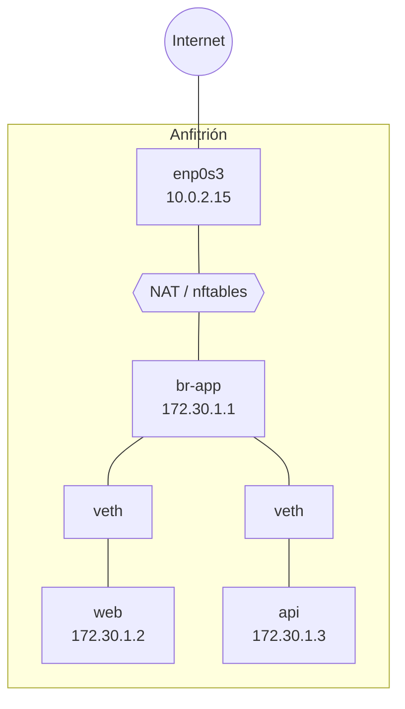
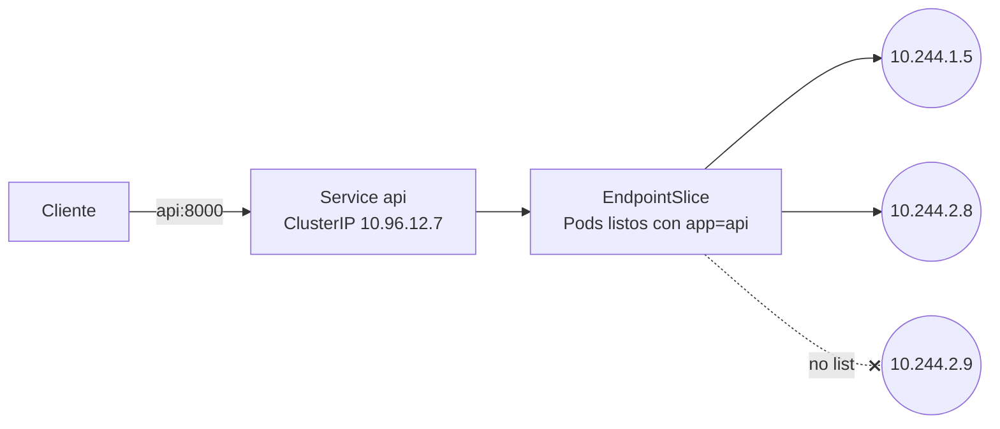
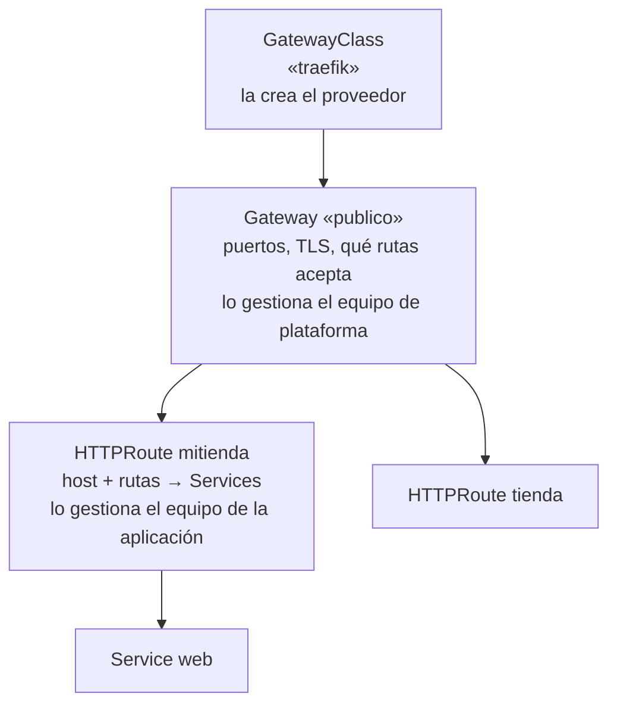
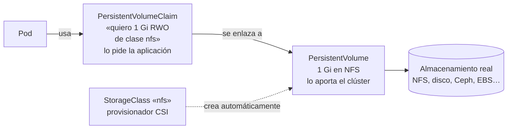

# UD04 · Redes, almacenamiento y volúmenes persistentes

## Resumen del tema

Los contenedores son efímeros y sus direcciones IP cambian cada vez que se recrean. Para que una aplicación funcione hace falta resolver dos problemas: **cómo se encuentran los servicios** (y cómo llega el tráfico de fuera) y **dónde viven los datos** cuando el contenedor desaparece. Docker y Kubernetes resuelven ambos con piezas parecidas: redes virtuales con DNS, puntos de entrada estables y volúmenes desacoplados del ciclo de vida del contenedor.



### Objetivos de aprendizaje

- Elegir el *driver* de red de Docker adecuado y usar el DNS interno.
- Explicar el modelo de red de Kubernetes y el papel del CNI.
- Exponer aplicaciones con Services `ClusterIP`, `NodePort` y `LoadBalancer`.
- Enrutar HTTP/HTTPS con Ingress y con Gateway API.
- Usar volúmenes con nombre, *bind mounts* y `tmpfs` en Docker.
- Aprovisionar almacenamiento persistente con PV, PVC y StorageClasses.

---

## 1. Redes en Docker

### 1.1 *Drivers* de red

| *Driver* | Cómo funciona | Uso |
|---|---|---|
| **bridge** (por defecto) | Puente virtual en el anfitrión (`docker0` o uno por red), un par `veth` por contenedor, NAT para salir | Contenedores en un único anfitrión |
| **host** | El contenedor usa la pila de red del anfitrión (sin namespace de red) | Máximo rendimiento, monitorización de red; sin aislamiento de puertos |
| **none** | Solo `lo` | Tareas sin red (procesado de ficheros) |
| **macvlan** / **ipvlan** | El contenedor obtiene una IP de la red física, como si fuera otra máquina | Aplicaciones heredadas que necesitan estar en la LAN |
| **overlay** | Túneles VXLAN entre varios anfitriones (Docker Swarm) | Contenedores de distintos servidores en la misma red |



### 1.2 Bridge por defecto frente a bridge definida por el usuario

| | `bridge` por defecto (`docker0`) | Red definida por el usuario (`docker network create`) |
|---|---|---|
| Resolución por nombre | **No** (solo IP) | **Sí**: DNS interno en `127.0.0.11` |
| Aislamiento | Todos los contenedores sin red explícita juntos | Solo los conectados a esa red |
| Conectar/desconectar en caliente | No | Sí (`docker network connect`) |
| Recomendación | Evitarla | **Siempre** (Compose la crea por ti) |

Un contenedor puede estar en **varias redes** a la vez: así separas el frontal de los datos (como en MiTienda, con `frontal` y `datos`). Una red con `--internal` no tiene salida a Internet.

### 1.3 Publicar puertos

`-p 8080:80` crea una regla DNAT en el anfitrión: lo que llega al 8080 se reenvía al 80 del contenedor. `-p 127.0.0.1:8080:80` publica solo en local.

> [!WARNING]
> **Docker añade sus propias reglas de cortafuegos** y los puertos publicados pueden quedar accesibles aunque tu política de `nftables`/`ufw` diga lo contrario. Publica solo lo necesario, en la IP necesaria, y filtra en la cadena `DOCKER-USER`.

### 1.4 Overlay y Docker Swarm

Una red *overlay* encapsula el tráfico entre contenedores de distintos anfitriones en **VXLAN** (UDP 4789). En Docker se usa con **Swarm**, el modo de clúster integrado:

```bash
docker swarm init --advertise-addr 192.168.56.10
docker network create -d overlay --attachable red-global
docker service create --name web --replicas 3 --network red-global -p 8080:80 nginx:1.29-alpine
```

Swarm incluye una **malla de enrutado** (*routing mesh*): el puerto publicado responde en **todos** los nodos y reparte entre las réplicas.

---

## 2. El modelo de red de Kubernetes

Kubernetes impone tres reglas, y deja que un **complemento CNI** las implemente:

1. **Cada Pod tiene su propia IP** en una red plana del clúster.
2. **Todos los Pods se comunican con todos**, en cualquier nodo, **sin NAT**.
3. Los agentes del nodo (kubelet) pueden comunicarse con todos los Pods del nodo.

| Tipo de comunicación | Cómo se resuelve |
|---|---|
| Contenedor ↔ contenedor del mismo Pod | `localhost` (comparten namespace de red) |
| Pod ↔ Pod | CNI (rutas, VXLAN, BGP o eBPF) |
| Pod → Service | IP virtual del Service, traducida por **kube-proxy** (o por el CNI con eBPF) |
| Exterior → Service | `NodePort`, `LoadBalancer`, Ingress o Gateway |

### 2.1 Complementos CNI

| CNI | Técnica | NetworkPolicy | Notas |
|---|---|:-:|---|
| **Flannel** | VXLAN | No | El más sencillo |
| **Calico** | Rutas BGP o VXLAN, nftables/eBPF | **Sí** | Muy extendido; lo usamos en kubeadm |
| **Cilium** | eBPF | **Sí** (también L7) | Puede sustituir a kube-proxy; observabilidad con Hubble |
| **kindnet** | Rutas simples | Básicas | El CNI de kind |

> [!IMPORTANT]
> Las **NetworkPolicies** (UD05) son objetos de la API, pero **las aplica el CNI**. Con Flannel puedes crearlas y no harán nada: el clúster no da ningún error. Comprueba siempre que tu CNI las soporta.

---

## 3. Services

Los Pods van y vienen y cambian de IP. Un **Service** da a un conjunto de Pods (elegidos por **etiquetas**) un **nombre DNS y una IP virtual estables**, y reparte el tráfico entre los que están **listos** (*readiness*).



### 3.1 Tipos de Service

| Tipo | Accesible desde | Cómo | Uso |
|---|---|---|---|
| **ClusterIP** (por defecto) | Solo dentro del clúster | IP virtual interna | Comunicación entre microservicios |
| **NodePort** | Fuera: `IP-de-cualquier-nodo:30000-32767` | Abre el mismo puerto en todos los nodos | Pruebas, o detrás de un balanceador externo |
| **LoadBalancer** | Fuera: IP pública/externa propia | Pide un balanceador al proveedor (nube) o a **MetalLB** (local) | Producción |
| **ExternalName** | Dentro | Alias DNS (CNAME) a un nombre externo | Bases de datos gestionadas externas |
| *Headless* (`clusterIP: None`) | Dentro | Sin IP virtual: el DNS devuelve las IP de los Pods | StatefulSets |

```yaml
apiVersion: v1
kind: Service
metadata: {name: web}
spec:
  type: NodePort
  selector: {app: web}
  ports:
    - port: 80          # puerto del Service
      targetPort: 8080  # puerto del contenedor
      nodePort: 30080   # (opcional) puerto en los nodos
```

Cada tipo **incluye** al anterior: un `LoadBalancer` también tiene `NodePort` y `ClusterIP`.

### 3.2 DNS del clúster

CoreDNS crea registros para cada Service:

```text
<servicio>.<espacio-de-nombres>.svc.cluster.local
api.mitienda.svc.cluster.local     → 10.96.12.7
db-0.db.mitienda.svc.cluster.local → IP del Pod db-0 (Service headless)
```

Desde el mismo espacio de nombres basta con `api`; desde otro, `api.mitienda`. Lo hace posible el `search` de `/etc/resolv.conf` de cada Pod.

### 3.3 MetalLB: LoadBalancer fuera de la nube

En un clúster propio nadie atiende las peticiones de `type: LoadBalancer` (se quedan en `<pending>`). **MetalLB** reparte IP de un rango de tu red y las anuncia por ARP (modo L2) o BGP. En el laboratorio, un rango de `192.168.56.0/24` hace que los servicios sean accesibles desde tu equipo.

---

## 4. Entrada HTTP: Ingress y Gateway API

Un `LoadBalancer` por aplicación es caro (una IP por servicio) y no entiende HTTP. Para enrutar **por nombre de dominio y ruta**, terminar **TLS** y compartir una única IP se usa un **controlador de entrada** (un proxy inverso dentro del clúster).

### 4.1 Ingress

```yaml
apiVersion: networking.k8s.io/v1
kind: Ingress
metadata: {name: tienda}
spec:
  ingressClassName: traefik
  tls:
    - hosts: [tienda.local]
      secretName: tienda-tls
  rules:
    - host: tienda.local
      http:
        paths:
          - path: /api
            pathType: Prefix
            backend: {service: {name: api, port: {number: 8000}}}
          - path: /
            pathType: Prefix
            backend: {service: {name: web, port: {number: 80}}}
```

El objeto Ingress solo **describe** las reglas; hace falta un **controlador** que las aplique (Traefik, HAProxy, NGINX de F5, Contour…).

> [!WARNING]
> **El controlador comunitario *Ingress NGINX* se retiró en marzo de 2026**: ya no recibe actualizaciones ni parches de seguridad, y el proyecto Kubernetes recomienda migrar. La API Ingress sigue existiendo pero está **congelada** (no evoluciona); para instalaciones nuevas se recomienda **Gateway API**. Encontrarás Ingress en muchos clústeres existentes, por eso lo estudiamos, pero en el curso usamos **Traefik** como controlador y Gateway API como forma principal.

### 4.2 Gateway API



Es la evolución de Ingress, diseñada por roles y extensible:



| | Ingress | Gateway API |
|---|---|---|
| Objetos | Uno | GatewayClass, Gateway, HTTPRoute (y GRPCRoute, TLSRoute…) |
| Separación de roles | No | Sí: plataforma (Gateway) / aplicaciones (rutas) |
| Funciones avanzadas | Anotaciones propias de cada controlador | En la especificación: reparto por pesos (*canary*), cabeceras, redirecciones, reescritura |
| Protocolos | HTTP/HTTPS | HTTP, HTTPS, gRPC, TCP, UDP, TLS |
| Estado | Congelado | En evolución; estándar recomendado |

```yaml
apiVersion: gateway.networking.k8s.io/v1
kind: HTTPRoute
metadata: {name: mitienda, namespace: mitienda}
spec:
  parentRefs: [{name: publico, namespace: traefik}]
  hostnames: [mitienda.local]
  rules:
    - matches: [{path: {type: PathPrefix, value: /}}]
      backendRefs:
        - {name: web, port: 80, weight: 90}
        - {name: web-canary, port: 80, weight: 10}   # canary nativo
```

---

## 5. Almacenamiento en Docker

| Tipo | Sintaxis | Dónde están los datos | Uso |
|---|---|---|---|
| **Volumen con nombre** | `-v datos:/var/lib/postgresql/data` | `/var/lib/docker/volumes/datos/_data`, gestionado por Docker | **Datos de aplicaciones** (recomendado) |
| **Bind mount** | `-v /srv/web:/usr/share/nginx/html:ro` | Una ruta concreta del anfitrión | Configuración, código en desarrollo |
| **tmpfs** | `--tmpfs /tmp:size=64m` | Memoria RAM | Temporales, datos sensibles que no deben tocar disco |
| Volumen anónimo | `-v /datos` | Como uno con nombre, pero con un hash | Evitarlo: difícil de identificar |

- `--mount type=volume,src=datos,dst=/data,readonly` es la sintaxis larga, más explícita.
- Los **volúmenes con nombre se inicializan** con el contenido de la imagen en esa ruta la primera vez; los *bind mounts* **ocultan** lo que hubiera.
- Los volúmenes **no se borran** con `docker rm` (sí con `docker rm -v` para los anónimos, `docker volume rm` o `compose down -v`).
- *Drivers* de volumen permiten guardar en NFS, CIFS o almacenamiento en la nube: `docker volume create --driver local --opt type=nfs --opt o=addr=192.168.56.10,rw --opt device=:/srv/nfs/datos datos-nfs`.

**Copia de seguridad de un volumen:**

```bash
docker run --rm -v datos-db:/origen:ro -v "$PWD":/copia alpine:3.22 \
  tar czf /copia/datos-db-$(date +%F).tar.gz -C /origen .
```

> [!CAUTION]
> Copiar los ficheros de una base de datos **en marcha** puede dar una copia inconsistente. Para bases de datos usa su herramienta (`pg_dump`, `mariadb-dump`) o para el servicio antes de copiar el volumen.

---

## 6. Almacenamiento en Kubernetes

### 6.1 Volúmenes efímeros

Viven lo que vive el **Pod** (sobreviven a reinicios del contenedor, no al borrado del Pod):

| Volumen | Uso |
|---|---|
| `emptyDir` | Compartir ficheros entre contenedores del Pod, caché, `/tmp` con sistema de archivos de solo lectura (`medium: Memory` para RAM) |
| `configMap`, `secret`, `downwardAPI`, `projected` | Inyectar configuración como ficheros |
| `hostPath` | Una ruta del nodo. **Peligroso** (acceso al nodo) y ata el Pod a ese nodo: solo para agentes del sistema |

### 6.2 Volúmenes persistentes: PV, PVC y StorageClass





| Objeto | Quién lo crea | Qué es |
|---|---|---|
| **PersistentVolume (PV)** | Administrador (estático) o provisionador (dinámico) | Un trozo de almacenamiento real del clúster |
| **PersistentVolumeClaim (PVC)** | Desarrollador, en su espacio de nombres | Una **petición** de almacenamiento: tamaño, modo de acceso y clase |
| **StorageClass** | Administrador | Un «tipo» de almacenamiento y **quién lo crea** (provisionador) con qué parámetros |

**Aprovisionamiento estático**: el administrador crea PV a mano y los PVC se enlazan con uno compatible. **Dinámico**: el PVC indica una StorageClass y el provisionador crea el PV al momento. Si una StorageClass está marcada como **por defecto**, los PVC sin clase la usan.

```yaml
apiVersion: v1
kind: PersistentVolumeClaim
metadata: {name: datos-web}
spec:
  accessModes: [ReadWriteMany]
  storageClassName: nfs
  resources:
    requests: {storage: 1Gi}
```

### 6.3 Modos de acceso y política de recuperación



| Modo | Significado | Ejemplos |
|---|---|---|
| `ReadWriteOnce` (RWO) | Lectura/escritura desde **un nodo** | Discos de bloque (EBS, discos locales) |
| `ReadOnlyMany` (ROX) | Solo lectura desde muchos nodos | Contenido estático compartido |
| `ReadWriteMany` (RWX) | Lectura/escritura desde muchos nodos | NFS, CephFS, Azure Files |
| `ReadWriteOncePod` (RWOP) | Desde **un único Pod** | Garantía de un solo escritor |

| `reclaimPolicy` | Al borrar el PVC… |
|---|---|
| `Delete` (por defecto en dinámico) | Se borran el PV y **los datos** |
| `Retain` | El PV queda `Released` con los datos; el administrador decide |

> [!CAUTION]
> Con `reclaimPolicy: Delete`, **borrar un PVC borra los datos**. Para bases de datos de producción usa una StorageClass con `Retain` o asegúrate de tener copias.

### 6.4 CSI

**Container Storage Interface** es el estándar para que cualquier fabricante escriba un controlador de almacenamiento sin tocar el código de Kubernetes. Ejemplos: `csi-driver-nfs`, Longhorn, Rook-Ceph, los de AWS/GCP/Azure. Además de crear volúmenes, CSI permite **ampliarlos** (`allowVolumeExpansion: true`) y hacer **instantáneas** (`VolumeSnapshot`).

| Provisionador | Modo | Notas |
|---|---|---|
| `local-path` (Rancher) | RWO | Directorio en el nodo; kind y k3s lo usan. El Pod queda atado a ese nodo |
| `csi-driver-nfs` | RWX | Un servidor NFS existente; sencillo para laboratorio |
| Longhorn / Rook-Ceph | RWO/RWX | Almacenamiento distribuido y replicado entre nodos |
| CSI de la nube | RWO (bloque) / RWX (ficheros) | EBS/EFS, Persistent Disk/Filestore, Azure Disk/Files |

---

## 7. Errores frecuentes

| Error | Causa | Solución |
|---|---|---|
| Contenedores no se resuelven por nombre | Están en la `bridge` por defecto | Red definida por el usuario |
| Puerto publicado accesible desde fuera pese al cortafuegos | Reglas propias de Docker | Publicar en `127.0.0.1` o filtrar en `DOCKER-USER` |
| Service sin respuesta | El selector no coincide con las etiquetas o los Pods no están listos | `kubectl get endpointslices -l kubernetes.io/service-name=web` |
| `EXTERNAL-IP <pending>` | No hay nada que implemente `LoadBalancer` | MetalLB o un proveedor de nube |
| HTTPRoute sin efecto | El Gateway no acepta rutas de ese espacio de nombres o el `hostname` no coincide | `kubectl describe httproute` → condiciones `Accepted` y `ResolvedRefs` |
| PVC en `Pending` | No hay StorageClass por defecto o ningún PV compatible | `kubectl describe pvc`; crear la clase o el PV |
| Pod en `ContainerCreating` con error de montaje NFS | Falta el cliente NFS en el nodo | `apt install nfs-common` en todos los nodos |
| Datos perdidos al borrar el PVC | `reclaimPolicy: Delete` | Clase con `Retain` y copias de seguridad |

## 8. Resumen

- En Docker usa **redes definidas por el usuario** (DNS por nombre) y separa capas con varias redes e `--internal`.
- Kubernetes: **una IP por Pod**, todos se ven sin NAT, lo implementa el **CNI**; solo algunos CNI aplican NetworkPolicies.
- **Services**: nombre e IP estables. `ClusterIP` dentro, `NodePort`/`LoadBalancer` fuera; MetalLB en local.
- Entrada HTTP: **Gateway API** (recomendada) o Ingress (congelada; Ingress NGINX retirado).
- Datos: **volúmenes con nombre** en Docker; **PVC → PV ← StorageClass** en Kubernetes, con el modo de acceso y la política de recuperación adecuados.

## 9. Autoevaluación


- q: "Dos contenedores en la red `bridge` por defecto no se encuentran por nombre. ¿Por qué?"
  options: ["Porque falta `--link`", "Porque solo las redes definidas por el usuario tienen DNS interno", "Porque el cortafuegos lo bloquea", "Porque no tienen IP"]
  answer: 1
  explain: "El DNS embebido de Docker (127.0.0.11) solo funciona en redes definidas por el usuario."
- q: "¿Qué *driver* de red permite que contenedores de dos anfitriones Docker distintos estén en la misma red?"
  options: ["bridge", "host", "overlay", "none"]
  answer: 2
  explain: "La red overlay usa túneles VXLAN entre los nodos de un Swarm."
- q: "¿Qué componente implementa la red entre Pods de distintos nodos?"
  options: ["kube-proxy", "El complemento CNI", "CoreDNS", "El scheduler"]
  answer: 1
  explain: "kube-proxy implementa las IP virtuales de los Services; la conectividad Pod a Pod la da el CNI."
- q: "Creas un Service `LoadBalancer` en tu clúster kubeadm y queda `<pending>`. ¿Qué falta?"
  options: ["Un Ingress", "Un implementador de LoadBalancer como MetalLB", "Más réplicas", "Una StorageClass"]
  answer: 1
  explain: "Fuera de la nube nadie atiende la petición de balanceador. MetalLB asigna IP de un rango local."
- q: "¿Cuál es el nombre DNS completo del Service `api` del espacio de nombres `mitienda`?"
  options: ["`api.cluster.local`", "`api.mitienda.svc.cluster.local`", "`mitienda.api.svc`", "`api.svc.mitienda.local`"]
  answer: 1
  explain: "El formato es `<servicio>.<espacio>.svc.cluster.local`."
- q: "¿Qué recurso de Gateway API define las reglas de enrutado de una aplicación (host y rutas hacia Services)?"
  options: ["GatewayClass", "Gateway", "HTTPRoute", "Ingress"]
  answer: 2
  explain: "El Gateway lo gestiona el equipo de plataforma; cada aplicación declara su HTTPRoute."
- q: "Necesitas que tres réplicas en nodos distintos escriban en el mismo volumen. ¿Qué modo de acceso pides?"
  options: ["ReadWriteOnce", "ReadOnlyMany", "ReadWriteMany", "ReadWriteOncePod"]
  answer: 2
  explain: "RWX permite lectura y escritura desde muchos nodos; requiere almacenamiento de ficheros compartido (NFS, CephFS…)."
- q: "Un PVC de una StorageClass con `reclaimPolicy: Delete` se borra por error. ¿Qué pasa con los datos?"
  options: ["Se conservan en el PV", "Se borran junto con el PV", "Pasan a la papelera", "Se copian a etcd"]
  answer: 1
  explain: "Con Delete el provisionador elimina el volumen real. Para datos críticos: Retain y copias."


## Referencias

- Docker: *Networking overview* y *Volumes* — <https://docs.docker.com/engine/network/> · <https://docs.docker.com/engine/storage/volumes/>
- Kubernetes: *Services, Load Balancing, and Networking* — <https://kubernetes.io/docs/concepts/services-networking/>
- Gateway API — <https://gateway-api.sigs.k8s.io/>
- Kubernetes: *Ingress NGINX Retirement: What You Need to Know* — <https://kubernetes.io/blog/2025/11/11/ingress-nginx-retirement/>
- Kubernetes: *Persistent Volumes* y *Storage Classes* — <https://kubernetes.io/docs/concepts/storage/>
- MetalLB — <https://metallb.io/> · Traefik — <https://doc.traefik.io/traefik/>
