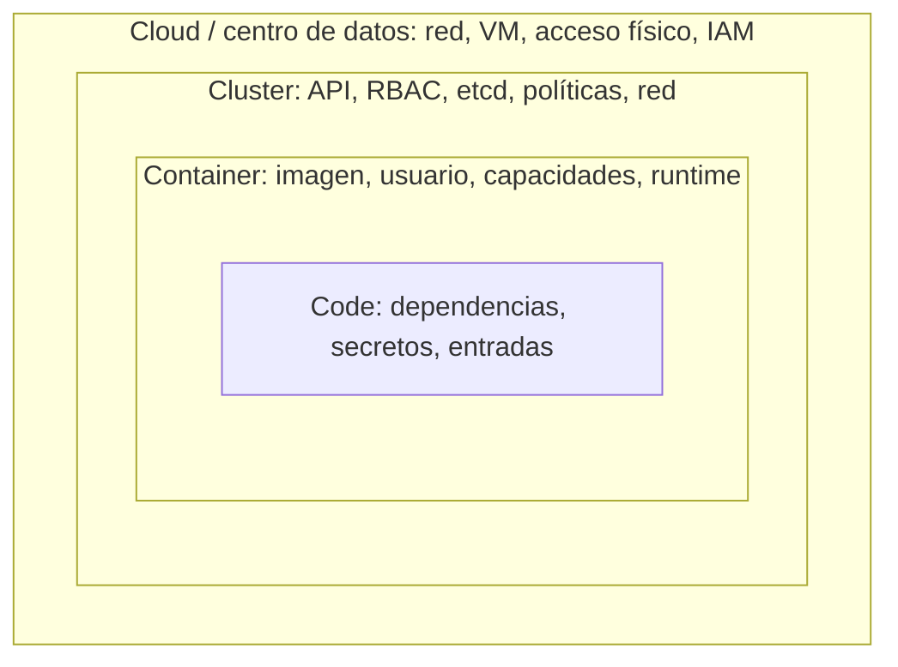
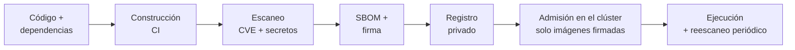
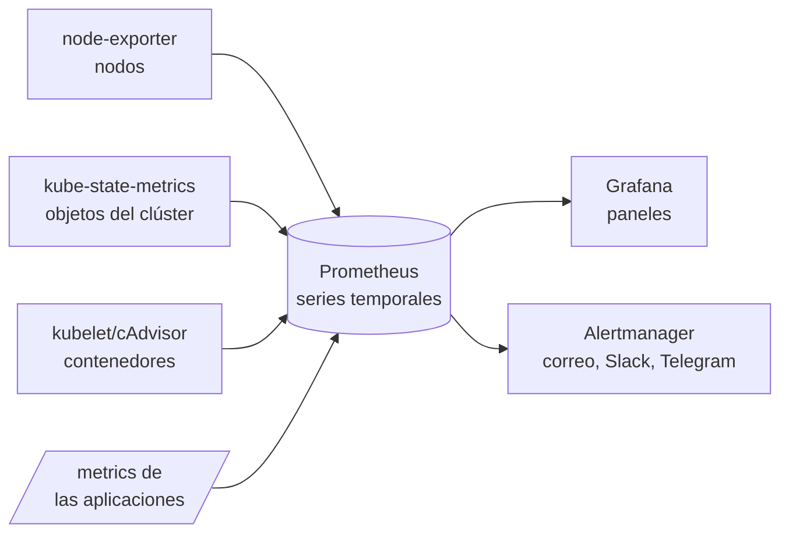

# UD05 · Seguridad, monitorización y buenas prácticas

## Resumen del tema

Los contenedores cambian **dónde** están los riesgos: ya no se parchea un servidor, se reconstruye una imagen; ya no hay un administrador con `root`, hay cuentas de servicio con permisos en una API; ya no se mira un fichero de registro, se agregan los de cientos de Pods que nacen y mueren. Esta unidad aplica el principio de **defensa en profundidad** a toda la pila y añade la **observabilidad** necesaria para operar con garantías y demostrar la **alta disponibilidad**.



### Objetivos de aprendizaje

- Identificar los riesgos de los contenedores y de la cadena de suministro de imágenes.
- Ejecutar contenedores con el mínimo privilegio en Docker y en Kubernetes.
- Escanear imágenes, generar SBOM y corregir vulnerabilidades.
- Configurar RBAC, cuentas de servicio, Pod Security Standards y cuotas.
- Restringir el tráfico con NetworkPolicies.
- Recoger métricas y registros, crear paneles y alertas.
- Diseñar y comprobar una aplicación en alta disponibilidad.

---

## 1. Modelo de amenazas: las 4C



Cada capa protege a la de dentro: un código perfecto no sirve si la API del clúster está abierta a Internet. Riesgos más frecuentes:

| Riesgo | Ejemplo real | Mitigación (en esta unidad) |
|---|---|---|
| **Imagen vulnerable** | Biblioteca con una CVE crítica conocida | Escaneo, imágenes mínimas, reconstrucción periódica |
| **Imagen maliciosa** (cadena de suministro) | Imagen con nombre parecido a una oficial que mina criptomonedas | Imágenes oficiales o propias, *digest*, firma, registro privado |
| **Escape del contenedor** | Contenedor privilegiado que monta el disco del nodo | Sin `root`, sin `--privileged`, capacidades mínimas, seccomp, PSS |
| **Movimiento lateral** | Una web comprometida accede directamente a la base de datos | NetworkPolicies, segmentación |
| **Abuso de permisos** | Un Pod con la cuenta de servicio por defecto puede leer Secrets | RBAC de mínimo privilegio |
| **Secretos expuestos** | Contraseña en el Dockerfile o en Git | Secrets, gestores externos, escaneo de secretos |
| **API o paneles expuestos** | Panel de administración o socket Docker accesible desde Internet | Red, autenticación, nunca exponer `docker.sock` |
| **Agotamiento de recursos** | Un Pod sin límites consume toda la memoria del nodo | *Limits*, LimitRange, ResourceQuota |

---

## 2. Cadena de suministro de imágenes





- **Imágenes base mínimas**: *slim*, Alpine, *distroless* o *Chainguard*. Menos paquetes = menos CVE y menos herramientas para un atacante.
- **Versiones fijas** y, en producción, ***digest***.
- **Escaneo** (Trivy, Grype, el de Harbor o el del registro en la nube) en el *pipeline* y periódicamente: cada día aparecen CVE nuevas en imágenes que ayer estaban limpias.
- **SBOM** (*Software Bill of Materials*, en formato SPDX o CycloneDX): la lista de todo lo que contiene la imagen. Cuando se publica una CVE nueva, sabes en minutos qué imágenes la tienen.
- **Firma** con **cosign** (Sigstore) y verificación en la admisión del clúster (Kyverno, Connaisseur, políticas de admisión).

> [!WARNING]
> Las **herramientas de seguridad también forman parte de la cadena de suministro**. Instálalas desde los repositorios oficiales, fija versiones y verifica sumas de comprobación o firmas cuando el proyecto las publique: un escáner manipulado ejecutándose en tu CI tiene acceso a tus credenciales.

**Interpretar un informe de vulnerabilidades:** la gravedad (CVSS) no lo es todo. Prioriza las que tienen **corrección disponible** (*Fixed Version*), las que afectan a paquetes que **realmente se usan** en ejecución y las que aparecen en el catálogo **KEV** (explotadas activamente). Las demás se documentan (por ejemplo, en un fichero `.trivyignore` con justificación y fecha de revisión).

---

## 3. Endurecimiento de contenedores

| Medida | Docker | Kubernetes (`securityContext`) |
|---|---|---|
| Usuario sin privilegios | `USER 10001` en la imagen, `--user` | `runAsNonRoot: true`, `runAsUser: 10001` |
| Sin escalada de privilegios (setuid) | `--security-opt no-new-privileges` | `allowPrivilegeEscalation: false` |
| Capacidades mínimas | `--cap-drop ALL --cap-add NET_BIND_SERVICE` | `capabilities: {drop: ["ALL"]}` |
| Sistema de archivos de solo lectura | `--read-only --tmpfs /tmp` | `readOnlyRootFilesystem: true` + `emptyDir` |
| Perfil seccomp | Por defecto activo | `seccompProfile: {type: RuntimeDefault}` |
| AppArmor/SELinux | `--security-opt apparmor=...` | `appArmorProfile`, `seLinuxOptions` |
| Límites de recursos | `--memory`, `--cpus`, `--pids-limit` | `resources.limits` |
| Sin acceso a la API si no hace falta | — | `automountServiceAccountToken: false` |
| Namespace de usuario | `userns-remap` o *rootless* | `hostUsers: false` (namespaces de usuario en Pods) |
| Prohibido | `--privileged`, `-v /var/run/docker.sock`, `--network host`, `--pid host` | `privileged`, `hostPath`, `hostNetwork`, `hostPID` |

**Docker Bench for Security** comprueba un anfitrión Docker contra la guía **CIS Docker Benchmark**; **kube-bench** hace lo mismo con el **CIS Kubernetes Benchmark**.

---

## 4. Control de acceso: autenticación y RBAC



### 4.1 Autenticación

Kubernetes **no tiene objetos de usuario**. Un usuario humano se identifica con un **certificado de cliente** firmado por la CA del clúster (el CN es el nombre y la O el grupo), con tokens OIDC de un proveedor de identidad (Keycloak, Entra ID, Google) o mediante el proveedor de la nube. Los **procesos** dentro del clúster se identifican con **ServiceAccounts**, que sí son objetos y reciben un **token** de duración limitada montado en el Pod.

### 4.2 Autorización con RBAC

| Objeto | Ámbito | Qué define |
|---|---|---|
| **Role** | Un espacio de nombres | Qué verbos sobre qué recursos |
| **ClusterRole** | Todo el clúster | Igual, o recursos sin espacio de nombres (nodos, PV) |
| **RoleBinding** | Un espacio de nombres | Asigna un Role (o ClusterRole) a usuarios, grupos o ServiceAccounts |
| **ClusterRoleBinding** | Todo el clúster | Asigna un ClusterRole en todos los espacios |

```yaml
apiVersion: rbac.authorization.k8s.io/v1
kind: Role
metadata: {name: desarrollador, namespace: bicialacant}
rules:
  - apiGroups: ["", "apps"]
    resources: ["pods", "pods/log", "deployments", "services", "configmaps"]
    verbs: ["get", "list", "watch", "create", "update", "patch"]
---
apiVersion: rbac.authorization.k8s.io/v1
kind: RoleBinding
metadata: {name: ana-desarrolladora, namespace: bicialacant}
subjects:
  - {kind: User, name: ana, apiGroup: rbac.authorization.k8s.io}
roleRef: {kind: Role, name: desarrollador, apiGroup: rbac.authorization.k8s.io}
```

RBAC solo **permite** (no hay reglas de denegación): lo que no se concede está prohibido. Comprobación: `kubectl auth can-i delete pods -n bicialacant --as ana`.

> [!CAUTION]
> Permisos especialmente peligrosos: `secrets` (leer contraseñas), `pods/exec` (ejecutar en cualquier Pod), crear Pods (montar cualquier Secret o `hostPath`), `escalate`/`bind`/`impersonate`, y cualquier `*`. Ten cuidado también con la ClusterRole `cluster-admin`: un `ClusterRoleBinding` a ella es la llave maestra.

---

## 5. Políticas de admisión y cuotas

### 5.1 Pod Security Standards (PSS)

El controlador de admisión **Pod Security** aplica tres niveles por espacio de nombres mediante etiquetas:

| Nivel | Qué permite |
|---|---|
| `privileged` | Todo (para componentes del sistema) |
| `baseline` | Prohíbe lo claramente peligroso: `privileged`, `hostNetwork`, `hostPath`, capacidades extra… |
| `restricted` | Además exige: no `root`, `allowPrivilegeEscalation: false`, `drop: ALL`, seccomp `RuntimeDefault` |

```yaml
metadata:
  labels:
    pod-security.kubernetes.io/enforce: restricted   # rechaza
    pod-security.kubernetes.io/warn: restricted      # avisa en kubectl
    pod-security.kubernetes.io/audit: restricted     # anota en la auditoría
```

Para reglas más finas (solo imágenes del registro propio, etiquetas obligatorias, nada de `latest`) se usan motores de políticas como **Kyverno**, **OPA Gatekeeper** o las **ValidatingAdmissionPolicy** nativas (con CEL).

### 5.2 ResourceQuota y LimitRange

- **ResourceQuota**: el total que puede consumir un espacio de nombres (CPU, memoria, número de Pods, PVC, Services `LoadBalancer`…).
- **LimitRange**: valores **por defecto** y máximos por contenedor. Así, un Pod que olvida sus *requests*/*limits* los recibe automáticamente (y la cuota puede calcularse).

---

## 6. Políticas de red



Por defecto, en Kubernetes **todo Pod puede hablar con todo Pod**. Una **NetworkPolicy** selecciona Pods por etiquetas y define qué tráfico de entrada (*ingress*) y salida (*egress*) se les permite. En cuanto un Pod está seleccionado por alguna política de un tipo, **todo lo no permitido de ese tipo se deniega**.

Patrón recomendado:

1. **Denegar todo** en el espacio de nombres (`podSelector: {}` sin reglas).
2. **Permitir DNS** de salida hacia CoreDNS (o nada resolverá nombres).
3. **Permitir explícitamente** cada flujo necesario: Traefik → web → api → db/cache.

```mermaid
flowchart LR
    T[traefik] -->|8080| W[web]
    W -->|8000| A[api]
    A -->|5432| D[(db)]
    A -->|6379| C[(cache)]
    W -.x.-> D
    X[otro espacio] -.x.-> A
```

Recuerda que **las aplica el CNI** (Calico, Cilium); en el curso, el clúster kubeadm con Calico.

---

## 7. Gestión de secretos



| Nivel | Medida |
|---|---|
| Básico | Secrets de Kubernetes, nunca en imágenes ni en Git; RBAC que limite quién los lee |
| Intermedio | **Cifrado en reposo** de etcd (`EncryptionConfiguration`); montar como fichero (no variable) |
| Avanzado | Gestor externo: **HashiCorp Vault/OpenBao**, *External Secrets Operator* (AWS Secrets Manager, Azure Key Vault…), **Sealed Secrets** (cifrados que sí se pueden subir a Git) |
| Prevención | Escaneo de secretos en el código y en las imágenes (Trivy, gitleaks) |

---

## 8. Observabilidad

| Pilar | Pregunta | Herramientas |
|---|---|---|
| **Métricas** | ¿Cuánto? ¿Va bien? (series numéricas) | Prometheus, Grafana, Alertmanager |
| **Registros** | ¿Qué ha pasado? (eventos de texto) | EFK/ELK, Loki, Fluent Bit |
| **Trazas** | ¿Por dónde ha pasado esta petición y cuánto tardó en cada servicio? | OpenTelemetry, Jaeger, Tempo |

### 8.1 Prometheus





- Modelo ***pull***: Prometheus **consulta** (*scrape*) cada 15-30 s el endpoint `/metrics` de cada objetivo.
- Las series tienen **nombre y etiquetas**: `container_memory_working_set_bytes{namespace="bicialacant", pod="api-7d9f-x2", container="api"}`.
- Se consultan con **PromQL**:

| Consulta | Significado |
|---|---|
| `up{job="apiserver"}` | ¿Está disponible el objetivo? (1/0) |
| `sum by (pod) (rate(container_cpu_usage_seconds_total{namespace="bicialacant"}[5m]))` | CPU por Pod |
| `sum by (pod) (container_memory_working_set_bytes{namespace="bicialacant", container!=""})` | Memoria por Pod |
| `kube_deployment_status_replicas_available{deployment="api"}` | Réplicas disponibles |
| `increase(kube_pod_container_status_restarts_total[1h]) > 3` | Contenedores que reinician mucho |

- **kube-prometheus-stack** (Helm) instala Prometheus, Alertmanager, Grafana, node-exporter, kube-state-metrics, paneles y reglas listos, y el **Prometheus Operator** con sus objetos `ServiceMonitor`/`PodMonitor` (qué medir) y `PrometheusRule` (alertas).

```yaml
apiVersion: monitoring.coreos.com/v1
kind: PrometheusRule
metadata:
  name: bicialacant
  namespace: monitorizacion
  labels: {release: kps}
spec:
  groups:
    - name: bicialacant
      rules:
        - alert: APISinReplicas
          expr: kube_deployment_status_replicas_available{namespace="bicialacant", deployment="api"} < 1
          for: 1m
          labels: {severity: critical}
          annotations:
            summary: "BiciAlacant: la API no tiene réplicas disponibles"
```

### 8.2 Registros centralizados



En Kubernetes los contenedores escriben en **stdout/stderr**; el *runtime* lo guarda en `/var/log/containers/` de cada nodo. Al borrarse el Pod (o el nodo), se pierden: hay que **recogerlos y centralizarlos**.

| Pila | Recolector (DaemonSet) | Almacén | Interfaz | Notas |
|---|---|---|---|---|
| **EFK** | Fluentd / **Fluent Bit** | **Elasticsearch** (u OpenSearch) | **Kibana** (u OpenSearch Dashboards) | Indexa el texto completo: búsquedas potentes, pero mucha RAM y disco |
| **ELK** | **Logstash** (+ Beats) | Elasticsearch | Kibana | Logstash transforma y enriquece; aún más pesado |
| **PLG** | Fluent Bit / Grafana Alloy | **Loki** | **Grafana** | Solo indexa etiquetas (como Prometheus): muy ligero; consultas con LogQL |

En el laboratorio se usa **Fluent Bit + Loki + Grafana**, porque la pila EFK necesita varios GB de RAM solo para Elasticsearch. Los conceptos (recolector por nodo, enriquecimiento con metadatos de Kubernetes, almacén y consulta) son los mismos.

> [!TIP]
> Las aplicaciones deben escribir **registros estructurados** (JSON) en stdout, con nivel, mensaje e identificador de petición. Así se filtran y correlacionan fácilmente con métricas y trazas.

---

## 9. Alta disponibilidad y tolerancia a fallos



| Capa | Punto único de fallo | Medida |
|---|---|---|
| Plano de control | Un solo `k8s-cp` con etcd | 3 nodos de plano de control (etcd con quórum 2 de 3) + balanceador para la API (kube-vip, HAProxy) |
| Nodos | Un nodo de trabajo | Al menos 2-3 nodos, capacidad sobrante para absorber la caída de uno |
| Aplicación sin estado | Una réplica | ≥ 2 réplicas, repartidas por nodos (antiafinidad / *topology spread*), PDB, sondas |
| Aplicación con estado | Un Pod de base de datos | Replicación propia (operador CloudNativePG, Patroni) o servicio gestionado; copias probadas |
| Almacenamiento | Un servidor NFS | Almacenamiento replicado (Longhorn, Ceph) o NFS en alta disponibilidad |
| Entrada | Un Pod de Traefik | ≥ 2 réplicas del controlador; IP de MetalLB que migra entre nodos |
| Configuración | Cambios a mano | Todo en Git (GitOps con Argo CD o Flux), copias de etcd |

**Comprobar, no suponer:** la alta disponibilidad se demuestra con **simulacros** (borrar Pods, vaciar y apagar nodos, cortar la red, llenar un disco) y midiendo el impacto (peticiones fallidas, tiempo de recuperación). Es lo que hace la *chaos engineering* (Chaos Mesh, LitmusChaos) de forma automatizada.

### 9.1 Buenas prácticas: lista de comprobación

- [ ] Imágenes mínimas, versionadas, escaneadas y en un registro propio.
- [ ] Ningún contenedor como `root`, sin privilegios, con `drop: ALL` y seccomp.
- [ ] *Requests* y *limits* en todos los contenedores; LimitRange y ResourceQuota por espacio de nombres.
- [ ] Sondas de *readiness* (dependencias) y *liveness* (el propio proceso).
- [ ] ≥ 2 réplicas repartidas, PDB y actualización `RollingUpdate` con `maxUnavailable: 0`.
- [ ] NetworkPolicies con denegación por defecto.
- [ ] RBAC de mínimo privilegio; nadie usa `admin.conf` en el día a día.
- [ ] Secretos fuera de Git y cifrado en reposo.
- [ ] Métricas, paneles, alertas y registros centralizados.
- [ ] Copias de etcd y de los volúmenes, **con restauración probada**.
- [ ] Todo declarativo y en Git; documentación de despliegue, operación y recuperación.

---

## 10. Errores frecuentes

| Error | Causa | Solución |
|---|---|---|
| El Pod es rechazado: `violates PodSecurity "restricted"` | Falta algún campo del `securityContext` | Leer el mensaje: dice exactamente qué falta |
| `permission denied` al escribir con `readOnlyRootFilesystem` | La aplicación escribe en `/tmp` o en su directorio | `emptyDir` en esas rutas |
| Tras aplicar NetworkPolicies, nada resuelve nombres | Se denegó también el DNS | Política de salida a `kube-dns` en el puerto 53 |
| `Forbidden: User "ana" cannot list pods` | Falta el RoleBinding o está en otro espacio de nombres | `kubectl auth can-i --as ana -n ...` |
| Prometheus no recoge las métricas de un servicio | El `ServiceMonitor` no lleva la etiqueta que espera el Prometheus del *chart* | Etiqueta `release: <nombre-del-release>` |
| La alerta nunca salta | La expresión no devuelve datos | Probar la consulta en la interfaz de Prometheus antes |
| Trivy muestra cientos de CVE | Imagen base completa y antigua | Base mínima y actualizada; priorizar las que tienen corrección |

## 11. Resumen

- Defensa en profundidad en las **4C**: nube, clúster, contenedor y código.
- **Cadena de suministro**: imágenes mínimas, versionadas, escaneadas, con SBOM y firmadas.
- **Mínimo privilegio** en todo: usuario, capacidades, sistema de archivos, RBAC, red y recursos.
- **PSS `restricted`**, cuotas y límites por espacio de nombres.
- **Observabilidad**: Prometheus + Grafana + Alertmanager para métricas, EFK/ELK o Loki para registros.
- La alta disponibilidad se **diseña** eliminando puntos únicos de fallo y se **demuestra** con simulacros.

## 12. Autoevaluación


- q: "¿Qué opción de `securityContext` impide que un proceso gane privilegios mediante binarios setuid?"
  options: ["`runAsNonRoot: true`", "`allowPrivilegeEscalation: false`", "`readOnlyRootFilesystem: true`", "`privileged: false`"]
  answer: 1
  explain: "Equivale a `no-new-privileges` de Docker: aunque haya binarios setuid, no se elevan privilegios."
- q: "¿Para qué sirve un SBOM?"
  options: ["Para cifrar la imagen", "Para conocer exactamente qué paquetes y versiones contiene una imagen y localizar rápidamente las afectadas por una CVE", "Para firmar la imagen", "Para reducir su tamaño"]
  answer: 1
  explain: "El SBOM es el inventario de componentes; se genera al construir y se guarda junto a la imagen."
- q: "En RBAC, ¿qué objeto asigna un Role a la ServiceAccount `monitor` en el espacio `bicialacant`?"
  options: ["ClusterRole", "RoleBinding", "NetworkPolicy", "ResourceQuota"]
  answer: 1
  explain: "El RoleBinding une sujetos (usuarios, grupos, ServiceAccounts) con un Role dentro de un espacio de nombres."
- q: "Aplicas una política de «denegar todo» en un espacio de nombres y los Pods dejan de resolver nombres. ¿Por qué?"
  options: ["Porque CoreDNS se ha caído", "Porque la salida al puerto 53 de kube-dns también quedó denegada", "Porque falta un Ingress", "Porque Calico no soporta DNS"]
  answer: 1
  explain: "Hay que permitir explícitamente la salida DNS hacia CoreDNS."
- q: "¿Qué nivel de Pod Security Standards exige ejecutar sin root y eliminar todas las capacidades?"
  options: ["privileged", "baseline", "restricted", "default"]
  answer: 2
  explain: "`restricted` es el nivel más estricto y el recomendado para aplicaciones."
- q: "¿Qué componente de la pila de Prometheus envía las notificaciones de las alertas?"
  options: ["Grafana", "node-exporter", "Alertmanager", "kube-state-metrics"]
  answer: 2
  explain: "Prometheus evalúa las reglas; Alertmanager agrupa, silencia y envía las notificaciones."
- q: "¿Qué diferencia principal hay entre Loki y Elasticsearch para almacenar registros?"
  options: ["Loki solo guarda métricas", "Loki indexa solo las etiquetas y es mucho más ligero; Elasticsearch indexa el texto completo", "Elasticsearch no admite Kubernetes", "No hay diferencia"]
  answer: 1
  explain: "Por eso EFK necesita mucha más memoria y disco, a cambio de búsquedas de texto más potentes."
- q: "Tu clúster tiene un único nodo de plano de control. ¿Qué ocurre si se apaga?"
  options: ["Se pierden todas las aplicaciones al instante", "Las aplicaciones siguen funcionando, pero no se pueden hacer cambios ni se reprograman Pods si falla algo", "Kubernetes elige otro nodo como plano de control automáticamente", "Los Services dejan de funcionar al instante"]
  answer: 1
  explain: "Sin apiserver ni controladores, el clúster queda «congelado»: por eso en producción se usan 3 nodos de plano de control."


## Referencias

- Kubernetes: *Security* (4C, Pod Security Standards, RBAC) — <https://kubernetes.io/docs/concepts/security/>
- OWASP *Docker Security Cheat Sheet* y *Kubernetes Security Cheat Sheet* — <https://cheatsheetseries.owasp.org/>
- CIS Benchmarks (Docker, Kubernetes) — <https://www.cisecurity.org/cis-benchmarks>
- Trivy — <https://trivy.dev/> · Sigstore/cosign — <https://docs.sigstore.dev/>
- Prometheus — <https://prometheus.io/docs/> · kube-prometheus-stack — <https://github.com/prometheus-community/helm-charts>
- Grafana Loki — <https://grafana.com/docs/loki/latest/> · Fluent Bit — <https://docs.fluentbit.io/> · Elastic Stack — <https://www.elastic.co/docs>
